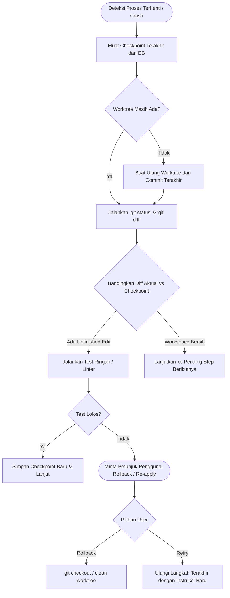

# PSEE — Agent Workflow & Git Worktree Isolation Architecture

**Document ID:** PSEE-WORKFLOW-003  
**Version:** 1.0.0  
**Status:** Approved Architecture Specification  
**Date:** 2026-11-02  
**Scope:** Multi-Agent Roles, Git Worktree Sandboxing, Checkpoint Recovery, & Human Approval Gates

---

## 1. Analisis Risiko Eksekusi Agent Otonom pada Workspace

Ketika sebuah AI Agent diberikan wewenang untuk memanipulasi file, menjalankan perintah terminal, dan memodifikasi kode repositori, terdapat beberapa risiko kritis yang dapat merusak integritas perangkat lunak jika tidak diisolasi secara ketat:

1. **Working Tree Contamination:** Agent mengedit file yang sedang aktif dikerjakan oleh developer di IDE, menyebabkan *dirty working tree*, konflik merge lokal, atau kehilangan perubahan yang belum di-commit.
2. **Race Conditions pada Multi-Agent:** Dua agent (misalnya Agent Coder A dan Agent Coder B) memodifikasi file yang sama secara paralel di direktori yang sama, menghasilkan *file corruption* atau *overwrite collision*.
3. **Silent Failure & Premature Success:** Agent melaporkan bahwa suatu fungsi telah berhasil dibuat padahal file hanya terbuat sebagian, sintaks rusak, atau kompilasi gagal.
4. **Destructive Command Execution:** Agent mencoba menjalankan perintah berbahaya seperti `git reset --hard`, `git push --force`, `rm -rf`, atau perintah pembersihan cache yang menghapus file penting pengguna.
5. **Loss of Context saat Process Crash:** Jika terjadi kegagalan jaringan atau proses agent terhenti mendadak saat proses pengeditan file berlangsung, sistem tidak memiliki rekam jejak untuk membedakan file mana yang sudah diubah dan mana yang belum.

---

## 2. Pola Arsitektur Git Worktree Isolation

Untuk mengatasi seluruh risiko di atas, PSEE mewajibkan seluruh agent eksekutor bekerja menggunakan **Git Worktree Isolation Pattern**. Direktori kerja utama pengguna (*main working directory*) tidak pernah dimodifikasi secara langsung oleh Agent selama proses pengerjaan tugas.

```mermaid
flowchart TD
    subgraph Repo_Root["Main Working Repository (/Users/.../PSEE)"]
        MainBranch["Branch: main (Clean / Protected)"]
        DevBranch["Branch: develop (Active Developer Work)"]
        GitStore[(".git Storage")]
    end

    subgraph Worktree_Manager["PSEE Worktree Manager"]
        Orchestrator["Task Orchestrator"]
        WT_Pool[(".psee/worktrees/")]
    end

    subgraph Isolated_Environments["Ephemeral Worktrees"]
        WT1[".psee/worktrees/task-101/ (Branch: task/101-auth)"]
        WT2[".psee/worktrees/task-102/ (Branch: task/102-db)"]
    end

    subgraph Agents["Role-Based Agents"]
        Coder1["Coder Agent 1"]
        Tester1["Tester Agent 1"]
        Coder2["Coder Agent 2"]
    end

    subgraph Review_Gate["Human-in-the-Loop Review Gate"]
        DiffViewer["Interactive Git Diff Viewer"]
        Approval{"User Approves Merge?"}
    end

    GitStore --> WT_Pool
    Orchestrator --> Worktree_Manager
    Worktree_Manager -->|"git worktree add -b task/101"| WT1
    Worktree_Manager -->|"git worktree add -b task/102"| WT2

    Coder1 & Tester1 -->|"Scoped File I/O & Tests"| WT1
    Coder2 -->|"Scoped File I/O & Tests"| WT2

    WT1 & WT2 -->|"Pre-merge Verification"| Review_Gate
    Review_Gate --> DiffViewer --> Approval
    Approval -- Ya -->|"Merge Task Branch"| DevBranch
    Approval -- Tidak / Revisi --> Orchestrator
```

### 2.1 Siklus Hidup Git Worktree (Worktree Lifecycle)

1. **Task Initialization:**
   - Ketika task baru dibuat dengan ID `task-<id>`, PSEE memeriksa bahwa repositori dasar dalam keadaan bersih atau mencatat commit SHA dasar (`base_commit_sha`).
   - Sistem menjalankan perintah:
     ```bash
     git worktree add -b task/<id> .psee/worktrees/task-<id> <base_commit_sha>
     ```
   - Worktree baru ini sepenuhnya terisolasi secara fisik di direktori `.psee/worktrees/task-<id>`, namun tetap berbagi objek Git internal yang sama secara efisien.
2. **Pre-Execution Checkpoint:**
   - Sebelum agent menyentuh file apa pun di worktree, sistem mencatat *Checkpoint 0*: commit SHA, daftar file awal, dan status branch.
3. **Scoped Execution:**
   - Agent Coder dan Agent Tester hanya diberikan izin *write* dan *execution* di dalam path direktori worktree spesifik tersebut.
   - Izin akses file keluar dari path worktree tersebut diblokir oleh sandbox runtime.
4. **Test & Validation Gate:**
   - Agent Tester menjalankan unit test di dalam worktree tersebut.
   - Jika pengujian gagal, perbaikan dilakukan di dalam worktree yang sama.
5. **Commit & Checkpoint:**
   - Setelah pekerjaan lolos pengujian di worktree, PSEE membuat Git commit lokal pada branch `task/<id>` dengan pesan commit deskriptif yang mencantumkan correlation ID.
6. **Human Approval & Merge:**
   - Sistem menyajikan `git diff` antara branch `task/<id>` dengan branch target kepada pengguna di antarmuka PSEE.
   - Pengguna menyetujui penggabungan (*merge*).
7. **Worktree Teardown:**
   - Setelah merge selesai, worktree dibersihkan:
     ```bash
     git worktree remove .psee/worktrees/task-<id>
     ```
   - Branch task dihapus jika sudah digabungkan, atau diarsipkan jika dibatalkan.

---

## 3. Matriks Peran & Batas Izin Multi-Agent

PSEE menerapkan prinsip hak akses minimal (*least privilege*) untuk setiap peran agent:

| Peran Agent | Tanggung Jawab Utama | Izin File System | Izin Eksekusi Perintah | Model AI yang Direkomendasikan |
|---|---|---|---|---|
| **Planner** | Dekomposisi kebutuhan pengguna menjadi task, dependency graph, dan acceptance criteria. | **Read-Only** (hanya membaca spesifikasi dan struktur folder). | Dilarang menjalankan perintah terminal. | Gemini Flash / Kilo Reasoning (Model penalaran konteks tinggi). |
| **Architect** | Mendesain interface modul, kontrak API, ERD database, dan mendeteksi risiko teknis. | **Read-Only** (membaca kode yang ada & referensi). | Dilarang menjalankan perintah terminal. | Gemini Flash / OpenAI Codex Reasoning. |
| **Researcher** | Meneliti dokumentasi API resmi, library, error log, dan basis pengetahuan. | **Read-Only** (hanya membaca file dokumentasi/web). | Read-only CLI tools (misal: `curl` ke endpoint publik dokumentasi). | Ollama Local / Free Cloud Web Search. |
| **Coder** | Mengimplementasikan kode, mengedit file program, dan refactoring. | **Read/Write Terisolasi** (hanya di dalam `.psee/worktrees/task-<id>/`). | Terbatas pada perintah linter dan format kode lokal. | Ollama `qwen2.5-coder` lokal atau Cloud Code Model via 9Router. |
| **Tester** | Menulis test case, menjalankan automated test runner, memverifikasi kriteria penerimaan. | **Read/Write Test Files** di dalam worktree. | Eksekusi test runner resmi (misal: `npm test`, `pytest`) di dalam worktree. | Ollama Local / Fast Cloud Model. |
| **Reviewer** | Memeriksa git diff, celah keamanan, kepatuhan arsitektur, dan potensi regresi. | **Read-Only** pada worktree dan git diff. | Dilarang menjalankan perintah terminal. | Model penalaran tinggi (Gemini / Codex Review). |
| **Documentation Agent** | Memperbarui dokumentasi teknis, markdown, dan changelog. | **Read/Write Terisolasi** (hanya direktori `docs/` dan file `.md`). | Dilarang menjalankan perintah kompilasi/eksekusi. | Ollama Local / Free Fast Cloud. |

---

## 4. Sistem Checkpoint & Interrupted Coding Recovery

### 4.1 Skema Data Checkpoint
Setiap checkpoint yang disimpan ke tabel `task_checkpoints` memuat:
- `checkpoint_id`, `task_id`, `execution_id`, `checkpoint_number`
- `workspace_ref`: Path absolut worktree aktif.
- `git_branch`: Nama branch task (misal: `task/101-auth`).
- `git_commit_sha`: Hash commit terakhir saat checkpoint dibuat.
- `dirty_worktree_summary`: Output dari `git status --porcelain`.
- `completed_steps`: Array JSON daftar sub-tugas yang telah lolos validasi.
- `pending_steps`: Array JSON daftar sub-tugas yang belum selesai.
- `changed_files`: Array JSON daftar path file yang dimodifikasi.
- `test_summary`: Hasil eksekusi test terakhir (pass/fail count, error stack).
- `created_at`: Timestamp ISO-8601.

### 4.2 Prosedur Pemulihan (Interrupted Coding Recovery)

Jika proses agent terhenti di tengah jalan (karena crash aplikasi, timeout jaringan, atau penghentian sistem):



1. **Langkah 1: Jangan Replay Membabi Buta.** Sistem tidak boleh langsung mengirim ulang prompt coding ke model, karena sebagian file mungkin sudah tersimpan di disk.
2. **Langkah 2: Inspeksi Git Diff.** PSEE memeriksa perbedaan antara kondisi worktree saat ini dengan commit terakhir.
3. **Langkah 3: Verifikasi Integritas Sintaks.** Jalankan linter atau kompilasi cepat untuk mengetahui apakah file terpotong di tengah-tengah token penutup.
4. **Langkah 4: Rekonsiliasi State.** Perbarui daftar `completed_steps` dan `pending_steps`.
5. **Langkah 5: Keputusan Manusia jika Ambigu.** Jika kondisi file rusak parah akibat pemutusan listrik atau crash mendadak, tawarkan opsi satu-klik kepada pengguna: **"Rollback ke Checkpoint Terakhir"** atau **"Lanjutkan dengan Pemandu Manual"**.

---

## 5. Human-in-the-Loop Approval Gate

PSEE menerapkan pagar pengaman (*guardrails*) interaktif di mana tindakan berisiko tinggi secara mutlak memerlukan konfirmasi dan persetujuan pengguna sebelum dieksekusi:

### 5.1 Matriks Tindakan yang Memerlukan Persetujuan
| Kategori Tindakan | Contoh Operasi Spesifik | Tingkat Risiko | Mekanisme Approval |
|---|---|---|---|
| **Git Operations** | `git merge task/* into main`, `git push origin`, `git tag` | TINGGI | Menampilkan ringkasan Git Diff dan commit log di UI sebelum merge. |
| **Destructive File I/O** | `rm`, `unlink`, menghapus direktori, menimpa file konfigurasi root (`.env`, `package.json`). | KRITIS | Dialog konfirmasi eksplisit dengan daftar path file yang akan dihapus. |
| **System & Shell Commands** | Instalasi paket global, modifikasi firewall/network, modifikasi permission file (`chmod`, `chown`). | KRITIS | Menampilkan string perintah tepat beserta alasannya, membutuhkan tombol "Approve". |
| **Database Operations** | Menjalankan migrasi DDL pada database produksi, perintah `DROP TABLE`, `TRUNCATE`. | KRITIS | Wajib konfirmasi password atau input konfirmasi teks ("CONFIRM DROP"). |
| **AI Provider Escalation** | Mengalihkan tugas dari Free Tier ke Model Berbayar (Tier 2 Cloud) akibat rate limit atau kehabisan kuota gratis. | SEDANG / BIAYA | Menampilkan estimasi biaya per-task dan persetujuan pengeluaran saldo. |
| **Data Transmission** | Mengirimkan kode atau dokumen berlabel `CONFIDENTIAL` ke model cloud eksternal. | TINGGI / PRIVASI | Peringatan privasi data dan konfirmasi izin transmisi data ke server vendor. |

### 5.2 Tindakan yang Diizinkan Tanpa Persetujuan (Auto-Approved)
- Operasi baca (*read-only*) pada file repositori yang relevan dengan tugas.
- Pengeditan dan penulisan file di dalam isolated worktree milik tugas tersebut (`.psee/worktrees/task-<id>/`).
- Eksekusi unit test runner terisolasi yang telah terdaftar dalam whitelist proyek (`npm test`, `vitest`, `pytest`).
- Pemanggilan model AI Tier 0 (Ollama lokal) dan Tier 1 (Free Cloud Tier resmi).
- Pencatatan log, pembuatan checkpoint, dan pembacaan metrik monitoring.

