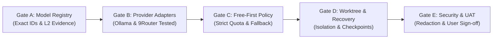

# PSEE — AI Agent Migration Acceptance Tests & Verification Matrix

**Document ID:** PSEE-TEST-004  
**Version:** 1.0.0  
**Status:** Approved Test Specification  
**Date:** 2026-11-02  
**Scope:** Phase-by-Phase Acceptance Criteria, Test Suites, Evidence Hierarchy, & Release Gates

---

## 1. Kerangka Kerja Verifikasi & Hirarki Bukti (Evidence Hierarchy)

Mengacu pada spesifikasi `AI_TESTING_STRATEGY.md`, PSEE melarang promosi status model atau modul agent tanpa rekaman bukti terverifikasi (*verifiable test evidence*). Seluruh model dan provider wajib diklasifikasikan ke dalam 5 tingkatan bukti:

| Level Bukti | Kriteria & Deskripsi | Status Routing Produksi |
|---|---|---|
| **L0 — Listed** | Model tercantum dalam dropdown, dokumentasi, atau respons daftar model penyedia. | **DILARANG** (Status: `UNKNOWN`) |
| **L1 — User-Reported Pass** | Pengguna secara verbal atau informal melaporkan bahwa model pernah berhasil diuji coba. | **DILARANG** (Status: `CONNECTIVITY_PASS_REPORTED`) |
| **L2 — Connectivity Verified** | Test harness otomatis PSEE berhasil mengeksekusi satu request terkontrol dan menerima respons valid. | **TERBATAS** (Hanya untuk health-check non-kritis) |
| **L3 — Capability Qualified** | Model berhasil menyelesaikan serangkaian benchmark terstandarisasi untuk kelas tugas spesifik (Coding, Review, Reasoning). | **DIIZINKAN** (Status: `QUALIFIED`) |
| **L4 — Operationally Qualified** | Model telah teruji stabil dalam skenario fallback, rate limit, pembatasan kuota, dan kepatuhan kebijakan data. | **PRIORITAS PRODUKSI** (Status: `PRODUCTION_ELIGIBLE`) |

---

## 2. Test Suites Berdasarkan Fase Migrasi

### Suite 0: Repositori & Git Baseline Acceptance Test
- **Test ID:** `TC-MIG-001`
- **Fase:** Fase 0 (Setup Repositori)
- **Tujuan:** Memastikan repositori diinisialisasi secara aman tanpa risiko kebocoran kredensial.
- **Langkah Pengujian:**
  1. Jalankan `git status` untuk memverifikasi repositori Git aktif.
  2. Periksa keberadaan file `.gitignore`.
  3. Buat file dummy `.env` berisi `SECRET_KEY=12345` dan periksa apakah terdeteksi oleh `git status`.
- **Kriteria Keberhasilan (Pass Assertion):**
  - Git repository berstatus aktif.
  - File `.env`, file `*.sqlite`, direktori `.psee/worktrees/`, dan `credentials/` terabaikan (*ignored*) oleh Git.
- **Kondisi Gagal (Failure Trigger):**
  - File `.env` atau database SQLite terdeteksi sebagai file untracked/staged oleh Git.
- **Rollback:** Hapus file dummy `.env`.

---

### Suite 1: Ollama Local Inference Acceptance Test
- **Test ID:** `TC-MIG-002`
- **Fase:** Fase 1 (Aktivasi Provider Lokal)
- **Tujuan:** Memvalidasi konektivitas ke daemon Ollama lokal dan kemampuan eksekusi kode mandiri.
- **Prasyarat:** Binary Ollama terpasang di host (`/usr/local/bin/ollama`).
- **Langkah Pengujian:**
  1. Kirim HTTP GET request ke `http://127.0.0.1:11434/api/tags`.
  2. Parse daftar model yang terpasang lokal; pastikan minimal 1 model coding (misal: `qwen2.5-coder`) tersedia.
  3. Kirim request inferensi minimal (JSON payload dengan prompt: `"Write a one-line Python function to add two numbers"`).
  4. Ukur waktu latensi pertama (*time-to-first-token*) dan waktu total respons.
- **Kriteria Keberhasilan (Pass Assertion):**
  - HTTP status 200 OK diterima dari loopback.
  - Model mengembalikan fungsi Python yang valid (`def add(a, b): return a + b`).
  - Tidak ada data yang dikirim ke jaringan eksternal.
  - Model dipromosikan ke status `CONNECTIVITY_VERIFIED` (L2).
- **Kondisi Gagal (Failure Trigger):**
  - Koneksi ditolak (*connection refused*) atau proses timeout melampaui 30 detik.

---

### Suite 2: 9Router Free Gateway & Connectivity Acceptance Test
- **Test ID:** `TC-MIG-003`
- **Fase:** Fase 1 (Aktivasi Gateway 9Router)
- **Tujuan:** Memvalidasi port inferensi API 9Router dan memetakan model-model yang benar-benar aktif.
- **Langkah Pengujian:**
  1. Kirim HTTP GET ke endpoint kesehatan 9Router (port 20128 atau port API yang dikonfigurasi).
  2. Jalankan satu panggilan inferensi terkontrol ke model kandidat Kilo Free (`kc/kilo-auto/free` atau model free lainnya) dengan timeout 15 detik.
  3. Tangkap format error jika terjadi kegagalan (normalisasi ke `NormalizedErrorCode`).
  4. Simpan hasil uji secara individual per-model ID di tabel `model_health_checks`.
- **Kriteria Keberhasilan (Pass Assertion):**
  - Gateway mengembalikan respons berformat OpenAI-compatible yang valid.
  - Error dinormalisasi dengan benar tanpa mengekspos raw auth header di log.
- **Kondisi Gagal (Failure Trigger):**
  - Status 401 unauthorized karena kunci gateway salah, atau status 404 karena path route inferensi keliru.

---

### Suite 3: OpenCode CLI / ACP Integration Acceptance Test
- **Test ID:** `TC-MIG-004`
- **Fase:** Fase 1 & 5 (Integrasi OpenCode)
- **Tujuan:** Memvalidasi antarmuka eksekusi tugas coding otomatis melalui OpenCode binary.
- **Prasyarat:** OpenCode v1.17+ terpasang di `/usr/local/bin/opencode`.
- **Langkah Pengujian:**
  1. Jalankan `opencode --version` dan verifikasi integritas binary.
  2. Buat direktori uji coba terisolasi (`/tmp/psee-opencode-test`).
  3. Jalankan OpenCode dalam mode headless/pure dengan instruksi membuat file `hello.txt`.
  4. Periksa apakah file `hello.txt` terbuat dengan isi yang benar.
- **Kriteria Keberhasilan (Pass Assertion):**
  - Proses keluar dengan kode status 0.
  - File `hello.txt` berhasil dibuat di direktori target.
- **Rollback:** Hapus direktori uji coba `/tmp/psee-opencode-test`.

---

### Suite 4: Database Schema, Migration, & Secret Store Acceptance Test
- **Test ID:** `TC-MIG-005`
- **Fase:** Fase 2 (Data Plane & Migrasi DB)
- **Tujuan:** Memverifikasi integritas 16 tabel relasional dan memastikan tidak ada secret plain text yang disimpan.
- **Langkah Pengujian:**
  1. Eksekusi migrasi DDL SQLite pada file database pengujian disposable.
  2. Verifikasi keberadaan seluruh 16 tabel: `ai_providers`, `ai_accounts`, `provider_connections`, `ai_models`, `model_capabilities`, `model_health_checks`, `provider_health_checks`, `routing_policies`, `routing_rules`, `agent_definitions`, `tasks`, `agent_executions`, `task_checkpoints`, `routing_logs`, `usage_records`, `provider_incidents`, `audit_events`.
  3. Lakukan pengujian rollback migrasi (down migration).
  4. Masukkan data pengujian ke `provider_connections` dan pastikan kolom `config_ref` hanya berisi alias referensi (bukan API key asli).
- **Kriteria Keberhasilan (Pass Assertion):**
  - Seluruh tabel, foreign keys, dan indexes berhasil terbuat tanpa error sintaks.
  - Migrasi rollback mengembalikan database ke kondisi awal tanpa artefak tertinggal.
  - Query audit tidak menemukan string pola API key (`sk-...`, `AIza...`) di tabel mana pun.

---

### Suite 5: Free-First Routing & Quota Fallback Acceptance Test
- **Test ID:** `TC-MIG-006`
- **Fase:** Fase 4 (Routing & Policy Engine)
- **Tujuan:** Memastikan sistem mematuhi hierarki Free-First dan menolak pemanggilan model berbayar tanpa persetujuan.
- **Skenario Pengujian A (Free Preference):**
  1. Daftarkan dua model yang memenuhi syarat untuk tugas coding: Model A (Ollama Local, Tier 0) dan Model B (Cloud Paid, Tier 2).
  2. Kirim tugas coding dengan data classification `INTERNAL`.
  3. **Assert:** Model A (Ollama) wajib dipilih oleh routing engine.
- **Skenario Pengujian B (Strict Approval Gate on Paid Fallback):**
  1. Simulasikan kegagalan pada seluruh model Tier 0 dan Tier 1 (simulasi rate limit 429 atau offline).
  2. Coba jalankan routing ke Model B (Cloud Paid).
  3. **Assert:** Sistem **TIDAK BOLEH** langsung memanggil Model B.
  4. **Assert:** Status task bertransisi menjadi `NEEDS_USER` / `PAUSED`, dan mencatat audit event `APPROVAL_REQUIRED_FOR_BILLABLE_ESCALATION`.

---

### Suite 6: Git Worktree Lifecycle & Isolation Acceptance Test
- **Test ID:** `TC-MIG-007`
- **Fase:** Fase 5 (Worktree Sandboxing)
- **Tujuan:** Memverifikasi bahwa dua agent yang bekerja paralel tidak saling menimpa file (*zero race condition*).
- **Langkah Pengujian:**
  1. Buat dua task paralel: `task-01` dan `task-02`.
  2. Worktree Manager membuat dua worktree:
     - `.psee/worktrees/task-01` (branch: `task/01`)
     - `.psee/worktrees/task-02` (branch: `task/02`)
  3. Agent pada `task-01` memodifikasi file `app.ts` di worktreenya.
  4. Agent pada `task-02` memodifikasi file `app.ts` yang sama di worktreenya dengan konten berbeda.
  5. Periksa file `app.ts` di direktori kerja utama pengguna (*main workspace*).
- **Kriteria Keberhasilan (Pass Assertion):**
  - File `app.ts` di main workspace tetap bersih (*untouched/unmodified*).
  - Masing-masing worktree memiliki versi file yang terisolasi tanpa konflik IO disk.
  - Setelah pengujian, perintah teardown menghapus kedua direktori worktree dengan bersih.

---

### Suite 7: Interrupted Coding & Checkpoint Crash Recovery Test
- **Test ID:** `TC-MIG-008`
- **Fase:** Fase 5 & 6 (Recovery Engine)
- **Tujuan:** Memverifikasi pemulihan tugas coding saat proses agent terputus di tengah jalan.
- **Langkah Pengujian:**
  1. Luncurkan tugas pengeditan file multi-step.
  2. Simpan Checkpoint 1 setelah langkah 1 selesai.
  3. Simulasikan penghentian paksa proses agent (*process kill / abort*) saat langkah 2 sedang menulis file.
  4. Nyalakan kembali PSEE Orchestrator.
  5. Jalankan modul `InterruptedCodingRecovery`.
- **Kriteria Keberhasilan (Pass Assertion):**
  - Sistem mendeteksi status run sebagai `INTERRUPTED`.
  - Sistem memeriksa status `git diff` terhadap Checkpoint 1 sebelum melakukan tindakan apa pun.
  - Sistem **tidak mengulang** (replay) prompt secara otomatis dari awal.
  - Sistem menyajikan opsi pemulihan kepada pengguna di UI (`Resume from Step 2` atau `Rollback to Checkpoint 1`).

---

### Suite 8: Security & Secret Redaction Acceptance Test
- **Test ID:** `TC-MIG-009`
- **Fase:** Fase 7 (Monitoring & Audit)
- **Tujuan:** Memastikan tidak ada token rahasia yang bocor ke file log terstruktur atau tabel monitoring.
- **Langkah Pengujian:**
  1. Simulasikan pemanggilan API gagal yang mengembalikan header otorisasi atau error pesan berisi string API key tiruan (`Bearer sk-test-dummy-key-999888`).
  2. Periksa output log pada file log dan tabel `audit_events` serta `model_health_checks`.
- **Kriteria Keberhasilan (Pass Assertion):**
  - String API key berhasil disaring (*redacted*) menjadi `Bearer [REDACTED]` atau `[SECRET_MASKED]`.
  - Correlation ID tetap terjaga untuk pelacakan debugging.

---

## 3. Matriks Validasi Release Gates (Gate A s/d Gate E)

Sebelum PSEE dinyatakan lulus dari fase audit dan migrasi ke status produksi, 5 gerbang rilis (*Release Gates*) wajib lolos verifikasi:

| Gerbang Rilis | Modul yang Diverifikasi | Syarat Mutlak Lolos (Mandatory Criteria) |
|---|---|---|
| **Gate A — Registry** | Model Catalog & Evidence Store | Tidak ada model berstatus `QUALIFIED` tanpa bukti pengujian L2/L3 nyata. Seluruh model kandidat berstatus `UNKNOWN`. Antigravity berstatus `QUARANTINED`. |
| **Gate B — Adapters** | Provider Interface & Network Layer | Ollama lokal lolos uji generasi. 9Router endpoint & auth header terverifikasi secara terkontrol. Direct provider terpisah dari IDE session. |
| **Gate C — Routing** | Policy Engine & Budget Controls | Hierarki Free-First aktif secara default. Round Robin global non-aktif. Pemanggilan model berbayar wajib memerlukan persetujuan pengguna. |
| **Gate D — Recovery** | Worktree Sandboxing & Checkpointing | Seluruh mutasi file berlangsung di `.psee/worktrees/`. Checkpoint selamat dari restart aplikasi. Pemulihan interrupted coding memeriksa `git diff`. |
| **Gate E — Security & UAT** | Redaction Engine & Human Verification | Pemindaian secret di repositori bersih (0 leak). Persetujuan manusia aktif untuk operasi destruktif. Pengguna menandatangani hasil UAT. |

