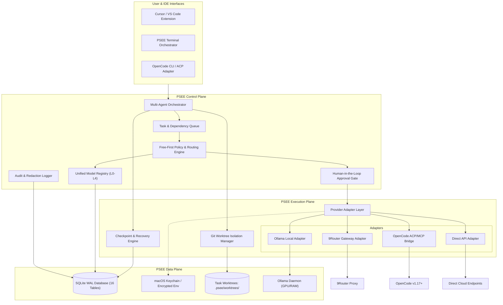
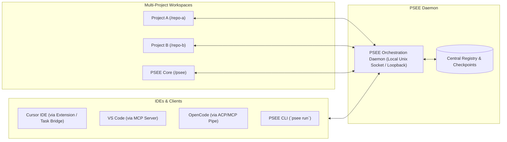

# PSEE — AI Agent Setup and Migration Plan
## Free-First Multi-Agent Orchestration Architecture

**Document ID:** PSEE-MIG-001  
**Version:** 1.0.0  
**Status:** Approved Architecture Draft for Implementation  
**Date:** 2026-11-02  
**Target Environment:** macOS Darwin (Node.js 24+, Python 3.15+, Ollama, OpenCode, 9Router)

---

## 1. Executive Summary & Migration Scope

Dokumen ini adalah rencana induk (*master migration roadmap*) untuk mentransformasi PSEE (Personal System Execution Environment) dari tahap perancangan arsitektur awal menjadi platform orkestrasi multi-agent yang otonom, aman, dan berorientasi **Free-First**.

### 1.1 Prinsip Desain Utama
1. **Zero Provider Lock-In:** Seluruh logika bisnis agent diisolasi dari format payload vendor melalui *Normalized Request/Response Layer*.
2. **Free-First Economic Model:** Prioritas pemilihan model mengutamakan komputasi lokal nol-biaya (Ollama), diikuti kuota gratis cloud resmi (Gemini Free Tier, OpenRouter/Kilo Free via 9Router), dan melarang eskalasi ke model berbayar tanpa persetujuan eksplisit pengguna.
3. **Multi-IDE & CLI Agnostic:** Mendukung lingkungan kerja pengembang lintas alat: Cursor, VS Code, OpenCode CLI/TUI (v1.17+), dan terminal shell mandiri.
4. **Git Worktree Isolation:** Setiap agent eksekutor (Coder, Tester) bekerja dalam isolated Git worktree terpisah untuk mencegah kontaminasi direktori kerja aktif dan race conditions.
5. **Durable Recovery & Checkpointing:** State pekerjaan dicatat sebelum dan sesudah setiap mutasi workspace; kegagalan proses atau timeout tidak menghilangkan progres.
6. **Strict Ethical & Policy Boundaries:** Kredensial akun tidak boleh diekstrak dari session browser/IDE tersembunyi; tidak ada teknik rotasi akun ilegal; tidak ada penyimpanan secret dalam log atau inventori.

---

## 2. Baseline Audit & Connectivity Taxonomy

### 2.1 Kondisi Lingkungan Saat Ini
- **Workspace:** `/Users/jofi/Documents/PROJECT/PSEE` (status: clean slate, belum diinisialisasi Git, 8 dokumen spesifikasi v1.0 tersedia).
- **Runtime Host Terpasang:**
  - Node.js v24.16.0 & npm 11.13.0
  - Python 3.15.2
  - Git version 2.50.1 (Apple Git-155)
  - Ollama runtime (`/usr/local/bin/ollama`)
  - OpenCode CLI (`/usr/local/bin/opencode` v1.17.13)
  - 9Router Proxy (terpasang di host macOS, dashboard port 20128)

### 2.2 Taksonomi 4 Moda Konektivitas Provider

| Moda Konektivitas | Mekanisme Autentikasi | Keamanan & Kepatuhan | Karakteristik Biaya | Contoh Target |
|---|---|---|---|---|
| **1. Local Inference** | Tidak ada (Local Unix Socket / Loopback HTTP `127.0.0.1:11434`) | Maksimal. Data tidak pernah meninggalkan mesin lokal. | Bebas biaya operasional; dibatasi RAM/GPU host. | Ollama (`qwen2.5-coder`, `deepseek-coder`, `llama3.2`) |
| **2. Gateway Proxy** | Local API Key / Bearer Token ke loopback gateway (`127.0.0.1:20128` atau port khusus) | Tergantung konfigurasi proxy. Secret upstream dikelola di dalam gateway vault. | Memanfaatkan kuota gratis atau akun yang dikonfigurasi di gateway. | 9Router Proxy (mengagregasi OpenAI Codex, Gemini, Kilo, dll.) |
| **3. Direct API-Key** | Official HTTP Header (`Authorization: Bearer <KEY>` atau `x-goog-api-key`) | Menggunakan API key resmi developer yang disimpan di OS Keychain / `.env` terenkripsi. | Mematuhi batas rate-limit resmi (RPM/RPD); gratis pada free tier resmi. | Google AI Studio, Groq Developer API, Mistral API |
| **4. CLI/IDE Subscriptions** | Headless CLI pipe, Agent Client Protocol (ACP), Model Context Protocol (MCP) | Menggunakan session resmi CLI tool yang sudah login; tidak boleh mengekstrak token mentah. | Sesuai lisensi alat terkait; tidak boleh dirotasi lintas identitas. | OpenCode (via ACP/MCP), Codex CLI (bila tersedia) |

---

## 3. Target System Architecture



---

## 4. Phase-by-Phase Migration Roadmap

### Fase 0: Repositori & Environment Baseline Setup
- **Tujuan:** Menyiapkan repositori Git, skema direktori standar, proteksi file rahasia, dan project manifest.
- **Langkah-langkah:**
  1. Inisialisasi Git: `git init`.
  2. Buat `.gitignore` ketat: mengabaikan `.env*`, `.psee/worktrees/`, `*.sqlite*`, `credentials/`, `node_modules/`, `logs/`.
  3. Siapkan project manifest (`package.json`, `tsconfig.json`) dengan target Node.js 24 + TypeScript.
  4. Susun struktur folder target:
     ```
     PSEE/
     ├── PSEE_AI_Infrastructure_v1.0/   # 8 dokumen spesifikasi awal
     ├── docs/audit/                    # Hasil audit lingkungan
     ├── src/
     │   ├── core/                      # Orchestrator, Task Queue, State Machine
     │   ├── registry/                  # Model & Provider Registry
     │   ├── policy/                    # Free-First Routing & Budget Engine
     │   ├── adapters/                  # Ollama, 9Router, OpenCode, Direct
     │   ├── isolation/                 # Git Worktree & Workspace Sandbox
     │   ├── checkpoint/                # Snapshot & Crash Recovery
     │   ├── monitoring/                # Correlation Logger & Audit
     │   └── db/                        # SQLite DDL, Migrations, Repositories
     └── config/                        # Template konfigurasi tanpa secret
     ```

### Fase 1: Local & Free Provider Activation & Spikes
- **Tujuan:** Memvalidasi koneksi ke runtime lokal dan gateway gratis tanpa menulis kode produksi.
- **Langkah-langkah:**
  1. **Ollama Spike:** Uji koneksi `http://127.0.0.1:11434/api/tags`, catat model yang terpasang lokal, lakukan 1 inferensi minimal (`qwen2.5-coder` atau model kecil yang tersedia).
  2. **9Router Spike:** Buka konfigurasi 9Router di host, temukan port inferensi API OpenAI-compatible (misal `/v1/chat/completions`), lakukan 1 tes curl terkontrol ke 1 model gratis (Kilo / OpenRouter Free).
  3. **OpenCode Integration Probe:** Uji kapabilitas `opencode acp` dan `opencode mcp` untuk evaluasi bridging agent.
  4. Simpan seluruh hasil pengujian sebagai evidence L2 di database/dokumentasi.

### Fase 2: Core Data Plane & Database Schema Implementation
- **Tujuan:** Mengimplementasikan 16 tabel relasional sesuai `AI_DATABASE_SCHEMA.md` menggunakan SQLite WAL mode.
- **Langkah-langkah:**
  1. Implementasi DDL dan versioned migration untuk:
     - `ai_providers`, `ai_accounts`, `provider_connections`, `ai_models`, `model_capabilities`, `model_health_checks`, `provider_health_checks`.
     - `routing_policies`, `routing_rules`, `agent_definitions`, `tasks`, `agent_executions`.
     - `task_checkpoints`, `routing_logs`, `usage_records`, `provider_incidents`, `audit_events`.
  2. Implementasikan Secret Reference Layer: kolom kredensial hanya menyimpan `config_ref`, bukan plain text API key.
  3. Lakukan pengujian migrasi rollback pada disposable database.

### Fase 3: Provider Adapter Layer & Model Registry Engine
- **Tujuan:** Membangun lapisan adapter terstandarisasi yang mengisolasi perbedaan payload vendor.
- **Langkah-langkah:**
  1. Implementasikan interface `ProviderAdapter` (`discoverModels`, `healthCheck`, `testModel`, `generate`, `stream`).
  2. Bangun `OllamaAdapter`: pemetaan prompt, deteksi hardware/VRAM, pembacaan parameter konteks.
  3. Bangun `NineRouterAdapter`: normalisasi header Authorization, translasi candidate model ID, error mapping (429, 5xx, timeout).
  4. Bangun `OpenCodeBridgeAdapter`: antarmuka ke OpenCode headless session untuk eksekusi tugas coding mandiri.
  5. Bangun `ModelRegistryService`: mengelola status siklus hidup model (`UNKNOWN`, `CONNECTIVITY_VERIFIED`, `QUALIFIED`, `QUARANTINED`, `DISABLED`).

### Fase 4: Free-First Routing & Budget Policy Engine
- **Tujuan:** Menerapkan algoritma pemilihan model cerdas yang memprioritaskan biaya nol.
- **Langkah-langkah:**
  1. Terapkan hierarki seleksi:
     - *Tier 0:* Local Ollama (untuk tugas yang muat di konteks/VRAM lokal).
     - *Tier 1:* Free Cloud Tiers (Gemini Free Tier resmi, Kilo/OpenRouter free models).
     - *Tier 2:* Standard Cloud via 9Router / Direct API (Hanya aktif bila ada token/saldo dan disetujui pengguna).
  2. Terapkan pemetaan kelas tugas:
     - `Planning` & `Architecture`: Memerlukan model penalaran tinggi (Gemini Flash / OpenRouter free reasoning).
     - `Coding` & `Unit Testing`: Model spesialis kode lokal (`qwen2.5-coder`) atau cloud code model.
     - `Documentation` & `Review`: Model berbobot ringan.
  3. Terapkan *Data Classification Gate*: data berkategori `SECRET` langsung dibatasi hanya ke `Tier 0` (Ollama lokal).

### Fase 5: Git Worktree Isolation & Workspace Sandbox
- **Tujuan:** Mencegah konflik file dan kerusakan repositori kerja saat agent melakukan coding.
- **Langkah-langkah:**
  1. Bangun `WorktreeManager`:
     - Setiap `task_id` membuat worktree baru di `.psee/worktrees/task-<id>` dari branch dasar yang bersih.
     - Mencegah perubahan langsung ke branch `main`/`master`.
  2. Bangun `CheckpointEngine`:
     - Mencatat Git commit SHA, git status dirty worktree summary, dan file changes sebelum agent mulai menulis file.
     - Menyimpan snapshot di tabel `task_checkpoints`.
  3. Bangun `InterruptedCodingRecovery`:
     - Jika eksekusi terputus (crash/timeout), sistem memeriksa `git diff` di worktree, menentukan status perubahan (parsial/utuh), dan melanjutkan tanpa replay prompt membabi buta.

### Fase 6: Multi-Agent Orchestration & Human Approval Gate
- **Tujuan:** Mengorkestrasikan interaksi multi-agent dengan kendali pengguna yang aman.
- **Langkah-langkah:**
  1. Definisikan 7 peran agent: Planner, Architect, Researcher, Coder, Tester, Reviewer, Documentation Agent.
  2. Pasang `HumanApprovalGate`:
     - Wajib meminta persetujuan manusia untuk: penggabungan (*merge*) worktree ke branch utama, eksekusi perintah terminal berisiko tinggi (`rm`, format disk, modifikasi network), eskalasi ke provider berbayar, dan transmisi data sensitif.
  3. Implementasikan state machine task 12-state (`QUEUED`, `RUNNING`, `CHECKPOINTED`, `PAUSED`, `FALLBACK_PENDING`, `VALIDATING`, `DONE`, `FAILED`, `INTERRUPTED`, `RECOVERING`, `NEEDS_USER`, `CANCELLED`).

### Fase 7: Observability, Audit, & UI Dashboard
- **Tujuan:** Memberikan transparansi operasional penuh tanpa kebocoran data rahasia.
- **Langkah-langkah:**
  1. Pasang Structured Logger dengan `correlation_id` pada setiap siklus request.
  2. Terapkan Redaction Engine: menyaring API key, password, dan header Authorization dari log.
  3. Bangun antarmuka monitoring 9 seksi (Overview, Provider Health, Model Registry, Agent Monitor, Routing Timeline, Usage & Cost, Quota Monitor, Recovery Center, Audit Log).
  4. Terapkan aturan "Unknown vs 0": metrik yang tidak memiliki kepastian data tidak boleh ditampilkan sebagai 0.

### Fase 8: Release Gates, Security Hardening, & UAT
- **Tujuan:** Memvalidasi seluruh sistem sebelum dinyatakan siap produksi.
- **Langkah-langkah:**
  1. Uji Release Gate A hingga E sesuai `AI_TESTING_STRATEGY.md`.
  2. Lakukan simulasi kegagalan: pemutusan gateway 9Router, simulasi 429 rate limit, simulasi crash mendadak pada proses agent coding.
  3. User Acceptance Testing (UAT): Pengguna memverifikasi eksekusi proyek nyata dari awal hingga selesai.

---

## 5. IDE & Multi-Project Integration Strategy



1. **Central Daemon vs Embedded Runner:**
   - PSEE berjalan sebagai background service lokal ringan (daemon) atau CLI per-proyek.
   - Menggunakan konfigurasi root workspace untuk menentukan batas sandboxing.
2. **OpenCode Integration (CLI/IDE):**
   - OpenCode v1.17+ memiliki dukungan bawaan untuk ACP (Agent Client Protocol) dan MCP (Model Context Protocol). PSEE bertindak sebagai MCP Host atau memanggil OpenCode via headless mode (`opencode run --pure`) untuk tugas coding spesifik.
3. **Cursor & VS Code Integration:**
   - PSEE menyediakan standard Model Context Protocol (MCP) server lokal sehingga Cursor dan VS Code dapat memanfaatkan Model Registry, Task Checkpoint, dan Git Worktree tools langsung dari editor.

---

## 6. Migration Governance & Next Steps

1. Rencana migrasi ini **tidak mengubah kode atau konfigurasi secara langsung** selama fase audit.
2. Setiap fase migrasi memiliki *Acceptance Criteria* yang wajib dipenuhi sebelum fase berikutnya dimulai (lihat dokumen `AI_AGENT_ACCEPTANCE_TESTS.md`).
3. Seluruh strategi kuota gratis dan penanganan provider diatur secara terpisah dalam `FREE_TIER_PROVIDER_POLICY.md`.
4. Mekanisme isolasi workspace dan mitigasi risiko agent diatur dalam `AGENT_WORKFLOW_AND_GIT_ISOLATION.md`.

