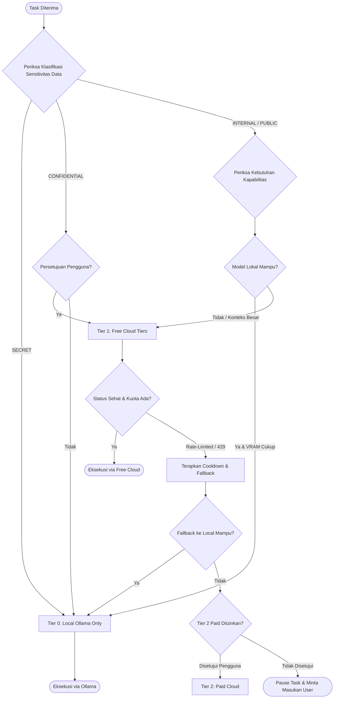
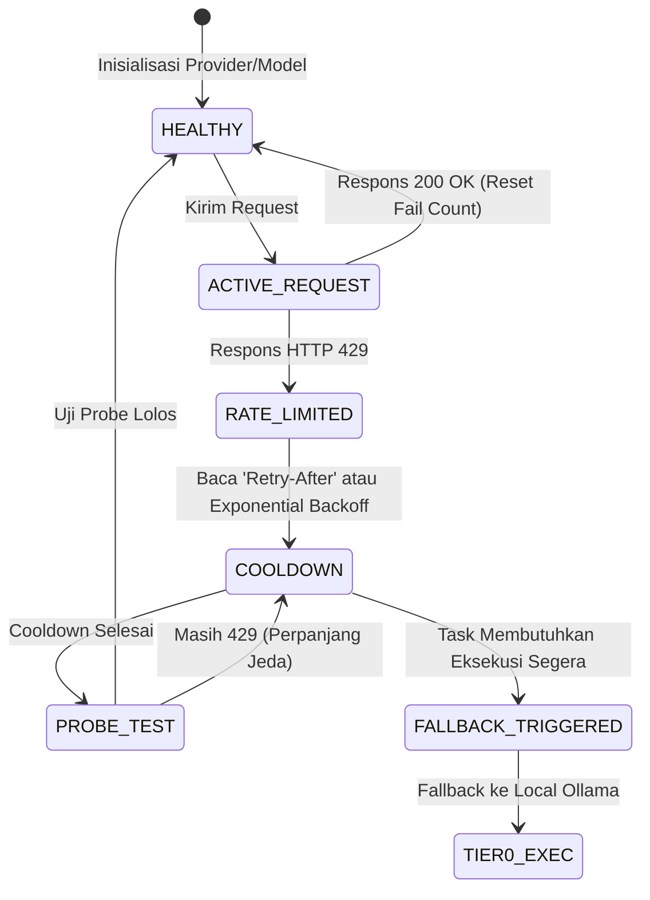

# PSEE — Free-First AI Provider Policy & Quota Governance

**Document ID:** PSEE-POL-002  
**Version:** 1.0.0  
**Status:** Approved Policy Specification  
**Date:** 2026-11-02  
**Scope:** AI Model Routing, Quota Management, Security Boundaries, & Cost Governance

---

## 1. Definisi & Filosofi "Free-First"

Strategi **Free-First** pada PSEE bukan berarti mengasumsikan bahwa semua layanan AI cloud dapat diakses secara gratis tanpa batas. Strategi Free-First adalah metodologi orkestrasian komputasi yang secara deterministik memilih rute eksekusi dengan biaya finansial marjinal terendah yang masih memenuhi syarat teknis (*capability & context requirements*), dengan perlindungan ketat terhadap privasi data dan kepatuhan hukum (*Terms of Service*).

### Prinsip Pokok
1. **Zero Financial Leakage by Default:** Sistem tidak boleh secara otomatis memicu pemanggilan API berbayar (*pay-per-token*) tanpa konfirmasi eksplisit dari pengguna.
2. **Local Workload Priority:** Jika model lokal (Ollama) mampu menyelesaikan tugas dalam batas waktu (*timeout*) dan kapasitas perangkat keras yang memadai, rute lokal wajib didahulukan.
3. **No Terms-of-Service Violation:** PSEE menolak metode eksploitasi seperti pemalsuan identitas (*identity spoofing*), rotasi akun massal untuk menghindari limit resmi (*rate-limit evasion*), atau ekstraksi token sesi rahasia dari aplikasi pihak ketiga.
4. **Honest Accounting:** Ketidaktersediaan data penggunaan kuota harus dicatat sebagai `UNKNOWN`, bukan `0` atau gratis.

---

## 2. Taksonomi Autentikasi & Keamanan Kredensial

PSEE membedakan 4 moda autentikasi dengan batas keamanan (*security boundary*) masing-masing:

```mermaid
flowchart TD
    subgraph Mode1["1. Local Inference (Ollama)"]
        L_Daemon["Local Daemon (127.0.0.1:11434)"]
        L_Auth["No Auth / Loopback Only"]
        L_Sec["Zero External Network Transmission"]
    end

    subgraph Mode2["2. Local Gateway (9Router Proxy)"]
        G_Client["PSEE Gateway Client"]
        G_Proxy["9Router Proxy (127.0.0.1:20128)"]
        G_Auth["Local Master Key / Token"]
        G_Upstream["Upstream Accounts Managed by 9Router"]
    end

    subgraph Mode3["3. Direct Developer API"]
        D_Client["PSEE Direct Adapter"]
        D_Vault["OS Keychain / Secure Config Store"]
        D_Official["Official Cloud API (Google AI Studio, etc.)"]
        D_Auth["Official API Key (Bearer Header)"]
    end

    subgraph Mode4["4. CLI / Subscribed IDE Sessions"]
        C_Client["PSEE Subprocess / Bridge"]
        C_Bin["OpenCode v1.17+ / Codex CLI"]
        C_Session["User-Authenticated Local Session"]
    end

    L_Daemon --- L_Auth --- L_Sec
    G_Client --> G_Auth --> G_Proxy --> G_Upstream
    D_Client --> D_Vault --> D_Auth --> D_Official
    C_Client --> C_Bin --> C_Session
```

### 2.1 Peraturan Autentikasi Ketat
- **Local Inference (Ollama):** Tidak memerlukan kredensial. Komunikasi hanya melalui loopback. Bebas risiko kebocoran API key.
- **Local Gateway (9Router Proxy):** PSEE hanya berkomunikasi dengan 9Router menggunakan konfigurasi endpoint lokal (`PSEE_9ROUTER_BASE_URL`) dan API key lokal (`PSEE_9ROUTER_API_KEY`). PSEE **tidak mengelola** akun Google, OpenAI, atau GitHub yang diikat di dalam 9Router; pengelolaan kredensial tersebut sepenuhnya wewenang proxy 9Router.
- **Direct Developer API:** Hanya menggunakan API key resmi yang diperoleh langsung dari konsol pengembang resmi (misal: Google AI Studio, Groq Cloud, OpenRouter). Kredensial dibaca dari variabel lingkungan aman atau OS Keychain, dan **dilarang disimpan di database dalam bentuk plain text**.
- **IDE Session Tokens:** PSEE **dilarang keras** membaca file database internal IDE (seperti SQLite milik Cursor, session token Antigravity, atau browser cookies) untuk meniru panggilan resmi. Interaksi dengan tool seperti OpenCode dilakukan melalui interface CLI resmi (`opencode run` / ACP / MCP).

---

## 3. Matriks Provider Free-Tier & Karakteristik Teknis

Berikut adalah pemetaan realistis provider dan model yang dievaluasi dalam PSEE:

| Provider / Channel | Tier / Lisensi | Kapasitas & Batasan Resmi | Implikasi Privasi Data | Status Registri PSEE |
|---|---|---|---|---|
| **Ollama Local** (`/usr/local/bin/ollama`) | 100% Free (Open Source Weights) | Tergantung RAM/VRAM host lokal. Kecepatan tergantung chip (Apple Silicon M-series). Konteks default biasanya 2k-8k token. | **Maksimal (Private).** Data tidak pernah dikirim ke internet. | `NEEDS_VERIFICATION` (Perlu tes aktifitas daemon & inventori model) |
| **Google Gemini Free Tier** (via Direct API / 9Router) | Free Tier Resmi Google AI Studio | 15 RPM (Requests Per Minute), 1 juta TPM, 1.500 RPD (Requests Per Day). | **Catatan Kritis:** Pada free tier resmi Google AI Studio, data prompt dapat digunakan untuk pelatihan model sesuai ToS. | `PARTIAL` (4 label dilaporkan lulus, upstream canonical ID perlu verifikasi) |
| **Kilo Free Models** (via 9Router: `kc/*:free`) | Sponsored / Community Free Tier | Model open-weights dihosting cloud. Rawan antrean (*cold start*), latensi bervariasi, limit harian tidak dijamin. | Bergantung pada provider hosting upstream via Kilo. | `PARTIAL` (11 kandidat terdaftar; per-model mapping wajib diuji) |
| **OpenAI Codex Models** (via 9Router: `cx/*`) | Terikat akun / proxy quota | 10 kandidat model terdaftar (`cx/gpt-5.6-*`, `cx/gpt-6-*`). Memiliki batasan kuota akun upstream. | Data diproses oleh endpoint OpenAI upstream. | `PARTIAL` (2 model dilaporkan lolos, 8 lainnya masih kandidat) |
| **OpenCode Built-In** (`/usr/local/bin/opencode`) | CLI Open Source | Mendukung provider gratis (Zen, Ollama, OpenRouter Free) melalui mekanisme konfigurasi OpenCode. | Bergantung pada provider yang diaktifkan dalam session OpenCode. | `IMPLEMENTED` (Binary v1.17.13 terpasang di host) |
| **Antigravity** (via 9Router) | Quarantined Integration | Seluruh model yang diuji sebelumnya dilaporkan gagal (timeout / not-found). | Belum dapat diverifikasi. | `QUARANTINED` (Wajib isolasi sampai pengujian diagnosis selesai) |
| **DeepSeek & Claude Code** | Commercial Paid API | Membutuhkan saldo/kartu kredit aktif; pengguna menyatakan belum diaktifkan. | - | `NOT_CONFIGURED` (Dikeluarkan dari rute v1.0) |

---

## 4. Kebijakan Routing Hierarkis (Free-First Tiering)

Algoritma pemilihan model PSEE menggunakan 4 tingkat prioritas (*Routing Tiers*):

### 4.1 Definisi Tingkat Prioritas

#### Tier 0: Zero Marginal Cost (Local Compute)
- **Komponen:** Ollama daemon lokal (`http://127.0.0.1:11434`).
- **Target Tugas:**
  - Kode sensitif (proprietary / secret).
  - Coding fungsi modular, parsing regex, refactoring lokal, unit test scaffolding.
  - Dokumentasi internal dan perapihan format.
- **Kondisi Diskualifikasi:** Ukuran file repositori melampaui jendela konteks model lokal, atau model tidak mendukung kapabilitas yang diminta (misal: analisis visual, penalaran multi-step rumit).

#### Tier 1: Verified Free Cloud Tiers (Community / Official Free Quota)
- **Komponen:**
  - Gemini Free Tier (via Direct API resmi atau 9Router).
  - Model Kilo Free (`kc/*:free`) dan OpenRouter Free yang telah terbukti lulus uji L2.
- **Target Tugas:**
  - Perencanaan arsitektur (*Architecture & Planning*) yang membutuhkan jendela konteks 32k+ token.
  - Review kode dan identifikasi celah keamanan tingkat lanjut.
  - Debugging masalah algoritma kompleks.
- **Kondisi Diskualifikasi:** Data berkategori `SECRET`, kuota harian habis, atau terjadi error 429 (Rate Limit).

#### Tier 2: Quota-Monitored Cloud (Standard Tiers)
- **Komponen:** Akun OpenAI Codex, model non-free di 9Router, atau Direct Paid API.
- **Kebijakan:** **NON-AKTIF SECARA OTOMATIS**. Hanya boleh dipilih jika:
  1. Pengguna secara eksplisit memberikan persetujuan (*Human Approval Gate*).
  2. Batas budget token per-task dikonfigurasi dan dipatuhi.
  3. Tier 0 dan Tier 1 gagal atau tidak memenuhi syarat minimum tugas.

---

## 5. Klasifikasi Sensitivitas Data & Batasan Privasi

Setiap tugas yang diajukan ke PSEE wajib diberi label klasifikasi data:

| Klasifikasi | Definisi & Contoh Data | Provider yang Diizinkan | Persetujuan Tambahan |
|---|---|---|---|
| `SECRET` | API keys, private certificates, kredensial DB, data finansial pribadi, kode proprietary tingkat tinggi. | **HANYA Tier 0 (Ollama Local)**. Dilarang keras keluar ke jaringan internet. | Tidak ada (otomatis dikunci ke lokal). |
| `CONFIDENTIAL` | Kode proyek internal perusahaan/pribadi, spesifikasi fitur internal yang belum dirilis. | Tier 0 (Ollama) dan Provider Cloud yang memiliki perjanjian privasi data tanpa pelatihan model (*Zero Data Retention*). | Konfirmasi persetujuan pengguna saat pertama kali inisialisasi tugas. |
| `INTERNAL` | Dokumentasi arsitektur umum, boilerplate kode generik, issue tracker. | Tier 0 (Ollama), Tier 1 (Free Cloud), Tier 2 (Gateway). | Tidak ada. |
| `PUBLIC` | Library open-source, algoritma publik, pencarian dokumentasi resmi, pertanyaan pemrograman umum. | Seluruh provider yang aktif dan sehat. | Bebas menggunakan seluruh rute. |

---

## 6. Penanganan Rate-Limit (429) & Cooldown State Machine

Free tier cloud secara inheren rentan terhadap batasan kecepatan (*rate limits*). PSEE mengimplementasikan penanganan deterministik:

### Aturan Teknis Penanganan 429:
1. **Header Parsing:** Jika provider mengembalikan header `Retry-After`, PSEE mengunci model tersebut selama durasi detik yang dinyatakan + jitter acak 1–5 detik.
2. **Exponential Backoff:** Jika tidak ada header, gunakan rumus:  
   $T_{\text{wait}} = \min(T_{\text{max}}, T_{\text{base}} \times 2^{\text{attempt}}) \pm \text{jitter}$  
   (dengan $T_{\text{base}} = 10\text{s}$, $T_{\text{max}} = 300\text{s}$, maks attempt = 3).
3. **Graceful Fallback:** Setelah 1 kegagalan 429, alihkan request berikutnya untuk task tersebut ke model alternatif yang setara di Tier yang sama, atau turun ke Tier 0 (Ollama).
4. **Anti-Throttling Guard:** Dilarang melakukan *busy-wait polling* atau spamming request saat model dalam status `RATE_LIMITED`.

---

## 7. Aturan Pengukuran Kuota, Biaya & Transparansi ("Unknown vs 0")

1. **Prinsip Kejujuran Metrik:**
   - Jika 9Router atau provider direct tidak mengirimkan metadata token (`usage.prompt_tokens`, `usage.completion_tokens`), nilai penggunaan harus disimpan sebagai `NULL` dan ditampilkan di antarmuka sebagai **"Unknown"**.
   - Dilarang keras menampilkan angka **0 Token** atau **\$0.00** jika data sebenarnya tidak diketahui, karena dapat menyesatkan pengguna seolah-olah operasi tersebut gratis atau tidak memakai kuota.
2. **Estimasi Biaya Lokal:**
   - Pemanggilan model Ollama lokal selalu dicatat dengan biaya finansial: `estimated_cost: 0.00`, `currency: "USD"`, `measurement_source: "local_hardware"`.
3. **Penyimpanan Log Bersih:**
   - Setiap transaksi mencatat `routing_logs` yang berisi alasan pemilihan model (*selection reason*) dan alasan perpindahan (*fallback reason*).

