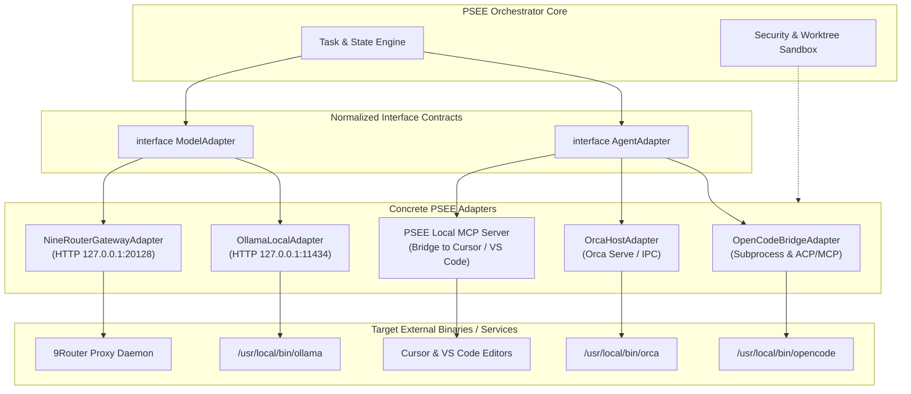

# PSEE — Agent Adapter Architecture & Unified Protocol Layer

**Document ID:** PSEE-ADP-004  
**Version:** 1.0.0  
**Status:** Approved Technical Architecture  
**Date:** 2026-11-02  
**Scope:** Universal Agent & Provider Abstraction Layer

---

## 1. Tujuan Arsitektur Adapter

Tujuan utama lapisan adapter PSEE adalah memastikan bahwa seluruh logika orkestrasi agent (Planner, Coder, Tester, Reviewer) sepenuhnya independen dari protokol bawaan vendor atau aplikasi pihak ketiga. Adapter bertindak sebagai jembatan dua arah (*bidirectional bridge*) yang menstandarisasi input, eksekusi, streaming output, dan penanganan error.



---

## 2. Kontrak Interface TypeScript Resmi

### 2.1 Interface `AgentAdapter` (Untuk Eksekutor CLI & IDE)

```typescript
export interface TaskExecutionContext {
  taskId: string;
  runId: string;
  role: "planner" | "architect" | "coder" | "tester" | "reviewer" | "docs";
  worktreePath: string; // Wajib: Path absolut ke .psee/worktrees/task-<id>/
  instructions: string;
  contextFiles: string[];
  timeoutMs: number;
  environmentVariables?: Record<string, string>;
  allowNetwork: boolean;
}

export interface TaskExecutionResult {
  taskId: string;
  runId: string;
  status: "SUCCESS" | "FAILED" | "TIMEOUT" | "INTERRUPTED";
  exitCode: number;
  modifiedFiles: string[];
  stdout: string;
  stderr: string;
  sanitizedSummary: string;
  durationMs: number;
}

export interface AgentAdapter {
  readonly id: string;
  readonly name: string;
  readonly version: string;
  
  isAvailable(): Promise<boolean>;
  healthCheck(): Promise<{ healthy: boolean; details: string }>;
  executeTask(context: TaskExecutionContext): Promise<TaskExecutionResult>;
  abortTask(runId: string): Promise<void>;
}
```

### 2.2 Interface `ModelAdapter` (Untuk Penyedia Inferensi LLM)

```typescript
export interface NormalizedRequest {
  requestId: string;
  taskId: string;
  modelId: string;
  messages: Array<{
    role: "system" | "user" | "assistant" | "tool";
    content: string;
  }>;
  temperature?: number;
  maxTokens?: number;
  timeoutMs: number;
}

export interface NormalizedResponse {
  requestId: string;
  providerId: string;
  modelId: string;
  content: string;
  finishReason: "stop" | "length" | "tool_calls" | "error";
  usage: {
    inputTokens: number | null;
    outputTokens: number | null;
    totalTokens: number | null;
  };
  latencyMs: number;
}

export interface ModelAdapter {
  readonly id: string;
  readonly type: "local" | "gateway" | "direct";

  discoverModels(): Promise<string[]>;
  healthCheck(): Promise<boolean>;
  generate(request: NormalizedRequest): Promise<NormalizedResponse>;
}
```

---

## 3. Implementasi Spesifik Adapter

### 3.1 `OpenCodeBridgeAdapter` (Target: Coder & Tester Agent)
- **Mekanisme Eksekusi:** Menjalankan binary `/usr/local/bin/opencode` menggunakan Node.js `child_process.spawn`.
- **Sandboxing:** Parameter `cwd` secara mutlak diarahkan ke `context.worktreePath`. Flag `--pure` diaktifkan untuk mencegah pemuatan plugin luar yang tidak disetujui.
- **Ekstraksi Hasil:** Memantau stream stdout/stderr untuk mendeteksi file yang diubah dan memastikan status exit code 0.

### 3.2 `OllamaLocalAdapter` (Target: Tier 0 Private LLM)
- **Mekanisme Eksekusi:** Menghubungi REST API loopback `http://127.0.0.1:11434/v1/chat/completions`.
- **Normalisasi Error:**
  - Connection refused $\rightarrow$ `PROVIDER_UNAVAILABLE` (daemon mati).
  - Out of memory / context exceeded $\rightarrow$ `CONTEXT_LIMIT_EXCEEDED`.
- **Privasi:** Header HTTP dijamin tidak mengandung token rahasia karena berjalan di loopback tanpa autentikasi.

### 3.3 `NineRouterGatewayAdapter` (Target: Tier 1 Free Cloud Models)
- **Mekanisme Eksekusi:** Mengirimkan payload OpenAI-compatible ke `http://127.0.0.1:20128` (atau port inferensi yang dikonfigurasi).
- **Format Header:** Menyisipkan `Authorization: Bearer ${PSEE_9ROUTER_API_KEY}`.
- **Translasi Model ID:** Memastikan prefix kandidat model (seperti `kc/*:free` untuk Kilo atau `cx/*` untuk Codex) dipetakan sesuai format yang diterima gateway.
- **Normalisasi Error:**
  - HTTP 429 $\rightarrow$ `RATE_LIMITED` (Memicu cooldown state machine).
  - HTTP 500/502/503 $\rightarrow$ `TRANSIENT_GATEWAY_ERROR` (Memicu retry dengan exponential backoff).
  - HTTP 404 $\rightarrow$ `MODEL_NOT_FOUND` (Mendiskualifikasi model dari registri aktif).

### 3.4 `PSEE Local MCP Server` (Target: Cursor & VS Code)
- **Mekanisme Eksekusi:** PSEE bertindak sebagai server Model Context Protocol (MCP) lokal melalui standard input/output (stdio) atau Server-Sent Events (SSE).
- **Tools yang Disediakan untuk Editor:**
  - `psee_list_tasks`: Menampilkan task yang sedang aktif.
  - `psee_view_checkpoint`: Menampilkan snapshot checkpoint dan git diff.
  - `psee_approve_merge`: Mengizinkan pengguna mengonfirmasi merge worktree ke branch utama langsung dari panel editor.

