# PSEE — Multi-Agent Compatibility & Synergy Matrix

**Document ID:** PSEE-MAT-003  
**Version:** 1.0.0  
**Status:** Approved Technical Matrix  
**Date:** 2026-11-02  
**Scope:** Cross-Platform Protocols, Tool Synergies, & Task Specialization

---

## 1. Matriks Kompatibilitas Protokol & Integrasi

Tabel berikut memetakan kapabilitas protokol teknis setiap komponen yang terpasang di mesin pengguna:

| Komponen | Tipe | MCP Support | ACP Support | OpenAI API Compat | Headless Mode | Git Worktree Friendly | Tingkat Lisensi / Biaya |
|---|---|---|---|---|---|---|---|
| **Ollama** (v0.31.1) | Local Engine | Via Server Wrapper | Tidak | **Native (`/v1`)** | **Ya (Daemon)** | **Maksimal** (Lokal) | **100% Free** (Open Source) |
| **OpenCode** (v1.17.13) | CLI Agent | **Native Client/Server** | **Native Server** | **Native Client** | **Ya (`opencode run/serve`)** | **Maksimal** (Target Coder) | **100% Free** (Open Source) |
| **Orca** (v1.4.245) | CLI / Studio | MCP Extensible | Internal IPC | Compatible | **Ya (`orca serve`)** | **Tinggi** (Multi-agent) | **Free Tier** |
| **9Router** (v0.5.112) | Gateway | Tidak | Tidak | **Native Endpoint** | **Ya (Background Proxy)** | Netral (Network proxy) | **Free Tool** (Proxy lokal) |
| **Cursor** (v3.27.22) | AI IDE | **MCP Client** | Tidak | Compatible | Terbatas (`cursor-tunnel`) | **Tinggi** (Manual Review) | **Freemium** (Free quota terbatas) |
| **VS Code** (v1.144.0) | Standard IDE | **MCP Client (Ext)** | Extension | Via Extensions | Ya (`code-tunnel`) | **Maksimal** (Standard editor) | **100% Free** (Code-OSS) |
| **Antigravity IDE** (v2.6) | Agentic IDE | Extensible | Custom | Custom Gateway | Tidak (Desktop GUI) | Sedang (IDE viewer) | **Freemium / Preview** |
| **Claude Code** (v2.1.201) | CLI Agent | Native Tools | Tidak | Tidak (Anthropic API) | Terbatas (Interactive TTY) | Tinggi | **PAID ONLY** (Berbayar) |

---

## 2. Matriks Kesesuaian Terhadap Klasifikasi Data & Tugas

Mengacu pada kebijakan keamanan [FREE_TIER_PROVIDER_POLICY.md](file:///Users/jofi/Documents/PROJECT/PSEE/FREE_TIER_PROVIDER_POLICY.md), berikut matriks kecocokan tugas dan sensitivitas data:

| Komponen | Status Sensitivitas Data (`SECRET` / `CONFIDENTIAL` / `PUBLIC`) | Peran Agent Terbaik (*Specialization*) | Kekuatan Utama (*Strengths*) | Kelemahan / Batasan (*Constraints*) |
|---|---|---|---|---|
| **Ollama Local** (`qwen2.5-coder`) | **SECRET, CONFIDENTIAL, INTERNAL, PUBLIC** | **Coder, Tester, Documentation** | Zero cost, data tidak keluar mesin, latensi nol dari network. | Terbatas oleh kapasitas VRAM/RAM Mac; konteks default 4k-8k token. |
| **Gemini Free Tier** (via 9Router/Direct) | **INTERNAL, PUBLIC** | **Planner, Architect, Reviewer** | Penalaran sangat tinggi, jendela konteks masif (1M token), kecepatan tinggi. | Kebijakan ToS free-tier mengizinkan penggunaan data prompt; limit 15 RPM. |
| **OpenCode CLI** (v1.17.13) | Tergantung Provider yang dihubungkan | **Autonomous Coder, Task Executor** | Sangat fleksibel, headless execution, dukungan ACP/MCP, format output rapi. | Membutuhkan model yang andal untuk menghindari loop eksekusi tak terhingga. |
| **Orca CLI** (v1.4.245) | Tergantung Provider | **Task Orchestrator, Multi-Agent Host** | Terintegrasi dengan manajemen akun agent, command context otomatis. | Memerlukan koordinasi session ID. |
| **Cursor IDE** (v3.27.22) | **CONFIDENTIAL, INTERNAL, PUBLIC** | **Human Reviewer & Diff Inspector** | Antarmuka visual review terbaik; multi-file diff presentation luar biasa. | Memerlukan interaksi GUI manual; kuota AI bawaan terbatas. |
| **VS Code** (v1.144.0) | Seluruh Tingkat | **Workspace Anchor & Fallback Editor** | Paling stabil, konsumsi RAM efisien, dukungan ekstensi terlengkap di dunia. | Tidak memiliki model AI bawaan tanpa ekstensi. |
| **Claude Code** (v2.1.201) | **CONFIDENTIAL (Berbayar)** | **Deep Refactoring & Security Audit** | Penalaran coding Claude 3.5 Sonnet sangat akurat. | **Memerlukan biaya (pay-per-token)**. Dikunci di balik Approval Gate PSEE. |

---

## 3. Kombinasi Sinergis yang Direkomendasikan (Recommended Agent Stacks)

PSEE mengelompokkan alat-alat di atas menjadi 3 pola kerja (*agent stacks*) yang optimal:

```mermaid
flowchart TD
    subgraph StackA["Stack A: 100% Free Solo Local Stack (Air-Gapped & Private)"]
        A_Orch["PSEE Orchestrator"] --> A_Ollama["Ollama Local (qwen2.5-coder)"]
        A_Ollama --> A_OpenCode["OpenCode CLI (Headless Worker)"]
        A_OpenCode --> A_WT[".psee/worktrees/task-xx/"]
        A_WT --> A_VSCode["VS Code (Local Diff Viewer)"]
    end

    subgraph StackB["Stack B: High-Reasoning Free Hybrid Stack (Rekomendasi Utama)"]
        B_Plan["Planner & Architect\n(Gemini Free via 9Router)"] --> B_Gate["Policy & Approval Gate"]
        B_Gate --> B_Code["Coder & Tester\n(Ollama Local / OpenCode)"]
        B_Code --> B_WT[".psee/worktrees/task-xx/"]
        B_WT --> B_Review["Reviewer & Human Approval\n(Cursor / VS Code UI)"]
    end

    subgraph StackC["Stack C: Headless Multi-Agent Swarm"]
        C_Orca["Orca CLI Host (Session Manager)"] <--> C_OpenCode["OpenCode Workers (ACP/MCP)"]
        C_Orca --> C_PSEE["PSEE Checkpoint & Audit Engine"]
    end
```

### Rekomendasi Utama: Stack B (High-Reasoning Free Hybrid)
1. **Fase Perencanaan (Planner/Architect):** Menggunakan **Gemini Free Tier** via 9Router untuk mencerna kebutuhan dokumen, menghasilkan arsitektur, dan membagi tugas ke JSON schema terstruktur (memanfaatkan konteks besar & penalaran tinggi tanpa biaya).
2. **Fase Eksekusi (Coder):** Menggunakan **OpenCode CLI** yang ditenagai **Ollama local `qwen2.5-coder`** untuk menulis fungsi, file, dan unit test di dalam isolated Git worktree.
3. **Fase Validasi (Tester):** Test runner dieksekusi secara lokal oleh PSEE runner.
4. **Fase Review (Human Gate):** Perubahan disajikan kepada developer melalui **Cursor** atau **VS Code** untuk persetujuan merge ke branch utama.

