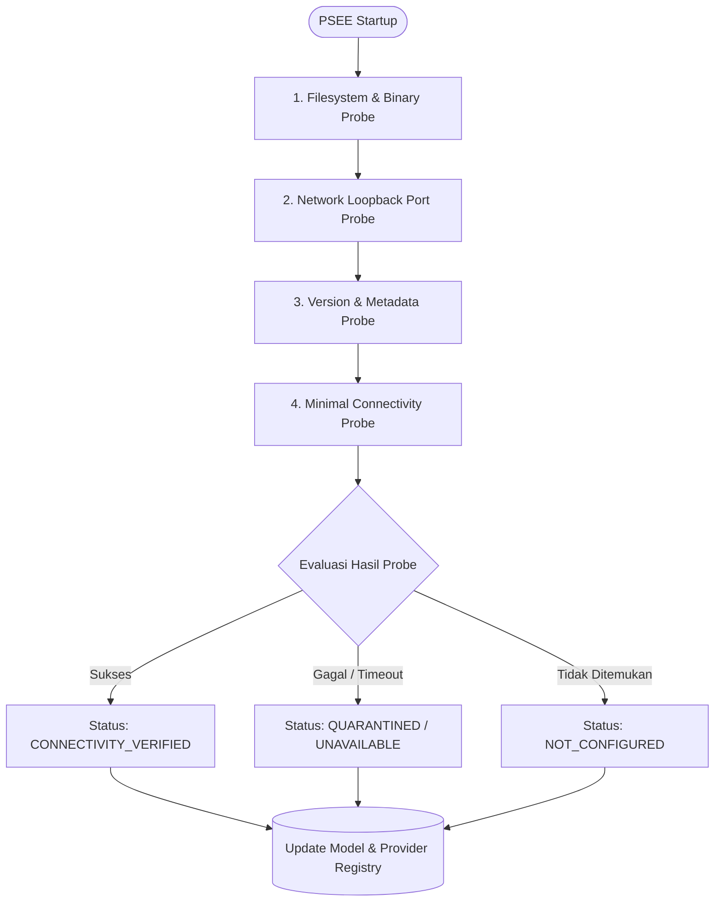
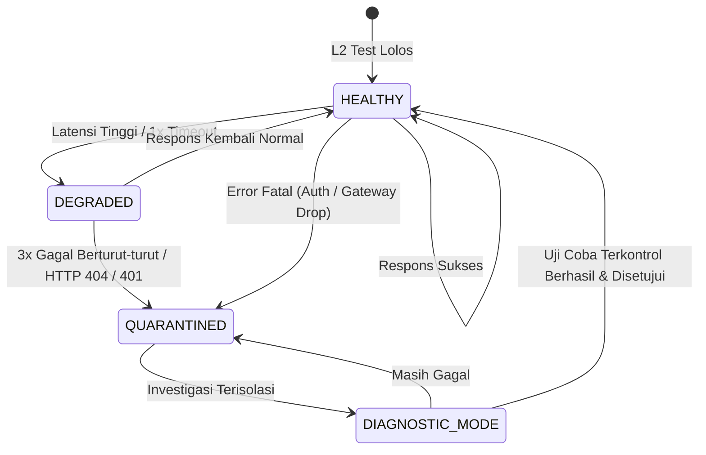

# PSEE — Agent Discovery, Healthcheck & Quarantine Protocol

**Document ID:** PSEE-DISC-006  
**Version:** 1.0.0  
**Status:** Approved Operational Protocol  
**Date:** 2026-11-02  
**Scope:** Dynamic Runtime Probing, Health Verification, & Fault Isolation

---

## 1. Protokol Penemuan Dinamis (Dynamic Discovery Protocol)

PSEE tidak mengasumsikan lokasi file atau port aplikasi secara kaku (*no brittle hardcoding*). Sistem menjalankan serangkaian probe otomatis saat inisialisasi lingkungan:



### 1.1 Tahapan Probing
1. **Binary & Application Probe:**
   - Memeriksa direktori standar macOS: `/Applications/`, `/usr/local/bin/`, `/opt/homebrew/bin/`.
   - Menggunakan perintah `which` atau validasi symlink untuk memastikan ketersediaan eksekusi.
2. **Loopback Port Probe:**
   - Memeriksa ketersediaan daemon lokal pada port target:
     - Ollama: `127.0.0.1:11434`
     - 9Router: `127.0.0.1:20128` (atau port yang didefinisikan pengguna)
     - OpenCode Daemon: `127.0.0.1:4096` (jika berjalan mode serve)
3. **Version & Metadata Probe:**
   - Menjalankan perintah non-destruktif (`--version`) atau membaca `CFBundleShortVersionString` dari `Info.plist` menggunakan `plutil`.
4. **L2 Controlled Connectivity Probe:**
   - Mengirimkan 1 request HTTP HEAD/GET atau inferensi minimal (maksimal 5 token) dengan timeout ketat (5-10 detik).

---

## 2. Prosedur Healthcheck & Siklus Evaluasi

PSEE memisahkan pemeriksaan kesehatan provider menjadi 2 level:

### 2.1 Provider Connection Health (Koneksi Gateway / Daemon)
- **Frekuensi:** Periodik (setiap 5–15 menit) atau *on-demand* sebelum task besar dimulai.
- **Beban:** Ringan (HTTP GET `/api/tags` untuk Ollama, HTTP GET `/health` untuk 9Router).
- **Aturan Kuota:** Dilarang menggunakan prompt token besar hanya untuk sekadar healthcheck agar tidak memboroskan kuota free-tier.

### 2.2 Model Generation Health (Inferensi Model Spesifik)
- **Frekuensi:** On-demand (ketika model hendak dialokasikan untuk sebuah task).
- **Payload:** Payload minimal: `{"messages": [{"role": "user", "content": "ping"}], "max_tokens": 1}`.

---

## 3. Protokol Karantina & Pemulihan (Quarantine Protocol)

Untuk melindungi stabilitas alur kerja pengembang, model atau provider yang bermasalah akan diisolasi secara otomatis:



### 3.1 Pemicu Karantina Otomatis (Quarantine Triggers)
Model atau koneksi langsung dialihkan ke status `QUARANTINED` jika:
1. Terjadi **3 kali timeout berturut-turut** ($> 30$ detik per request).
2. Provider mengembalikan **HTTP 404 (Model Not Found)**, menandakan nama model keliru atau dihapus.
3. Provider mengembalikan **HTTP 401 / 403**, menandakan kredensial kedaluwarsa atau tidak sah.
4. Model mengalami kegagalan konsisten seperti kasus **Antigravity** pada pengujian awal.

### 3.2 Efek Karantina
- Model yang berstatus `QUARANTINED` **seketika diblokir dari seluruh algoritma routing otomatis**.
- Tugas yang sedang berjalan dialihkan ke model fallback yang sehat.
- Notifikasi peringatan dibuat di dashboard monitoring PSEE.

### 3.3 Alur Pemulihan dari Karantina (Unquarantine Sequence)
1. Periksa konfigurasi di level gateway (misal: verifikasi akun di UI 9Router).
2. Jalankan pengujian terisolasi (*Isolated Diagnostic Test*) secara manual melalui perintah uji PSEE:
   ```bash
   psee test provider antigravity --model <exact_id> --timeout 15000
   ```
3. Jika uji diagnostik berhasil mengembalikan respons 200 OK dan teks valid, catat hasil pengujian sebagai evidence L2 baru di tabel `model_health_checks`.
4. Pengguna menyetujui pemulihan status (*manual unquarantine approval*).
5. Model dipromosikan kembali ke status `CONNECTIVITY_VERIFIED`.

---

## 4. Format Event Schema & Keamanan Redaksi Log

Setiap event pemeriksaan kesehatan dicatat dengan format JSON terstruktur yang menyaring kredensial:

```json
{
  "event_id": "evt_hc_98234",
  "timestamp": "2026-11-02T21:40:00Z",
  "correlation_id": "corr_probe_01",
  "component_name": "9router_gateway",
  "component_type": "gateway",
  "target_model": "kc/kilo-auto/free",
  "probe_type": "L2_CONNECTIVITY",
  "status": "PASS",
  "latency_ms": 420,
  "http_status": 200,
  "sanitized_detail": "Handshake successful; received valid OpenAI-compatible chunk",
  "auth_redacted": true
}
```

> [!CAUTION]
> Dilarang menyertakan nilai token `Authorization: Bearer ...` atau cookie dalam kolom `sanitized_detail`. Seluruh header otorisasi wajib dipotong menjadi `[REDACTED]`.

