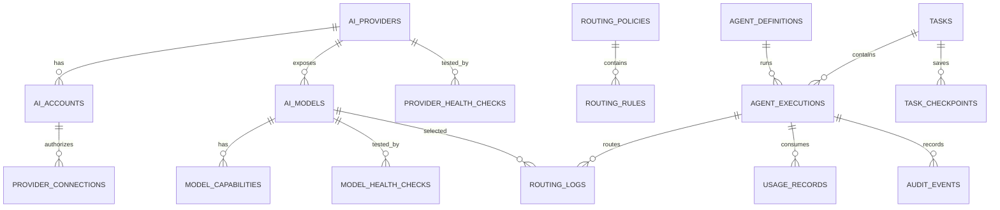

# PSEE — AI Database Schema

**Document ID:** PSEE-AI-DB-007  
**Version:** 1.0.0  
**Status:** Draft for implementation  
**Last updated:** 2026-11-02

## 1. Design goals

- Persist provider/model configuration separately from runtime events.
- Preserve exact model IDs.
- Support gateway, direct, and local adapters.
- Record evidence and provenance for health/capability claims.
- Support multi-agent execution, checkpoint recovery, audit, and usage.
- Never store raw secrets in ordinary relational tables.

The schema below is logical and database-agnostic. Adapt data types and indexes to the selected database.

## 2. Entity relationship diagram

## 3. Tables

### `ai_providers`
- `id` (PK)
- `provider_key` (unique)
- `display_name`
- `provider_type` (`cloud`, `local`, `gateway`)
- `status`
- `created_at`, `updated_at`

### `ai_accounts`
- `id` (PK)
- `provider_id` (FK)
- `account_ref` (opaque internal ID)
- `masked_label`
- `status`
- `created_at`, `updated_at`

Do not store passwords, OAuth refresh tokens, or API keys here.

### `provider_connections`
- `id` (PK)
- `provider_id` (FK)
- `account_id` (nullable FK)
- `adapter_type` (`gateway`, `direct`, `local`)
- `config_ref` (reference to secure configuration/secret store)
- `base_url_ref` (optional secret/config reference)
- `status`
- `last_verified_at`
- `created_at`, `updated_at`

### `ai_models`
- `id` (PK)
- `provider_id` (FK)
- `model_key` (exact identifier)
- `display_name`
- `status`
- `context_window` (nullable)
- `max_output_tokens` (nullable)
- `enabled`
- `source` (`user_reported`, `discovered`, `verified`)
- `created_at`, `updated_at`
- Unique constraint: (`provider_id`, `model_key`, `adapter_type` or equivalent connection scope)

### `model_capabilities`
- `id` (PK)
- `model_id` (FK)
- `capability_key`
- `status` (`unknown`, `pass`, `fail`)
- `benchmark_version`
- `evidence_ref`
- `tested_at`

### `model_health_checks`
- `id` (PK)
- `model_id` (FK)
- `connection_id` (FK)
- `status`
- `normalized_error_code`
- `sanitized_detail`
- `latency_ms`
- `tested_at`
- `evidence_source`

### `provider_health_checks`
- `id` (PK)
- `provider_id` (FK)
- `connection_id` (FK)
- `status`
- `sanitized_detail`
- `tested_at`

### `routing_policies`
- `id` (PK)
- `policy_key` (unique)
- `version`
- `description`
- `enabled`
- `created_at`, `updated_at`

### `routing_rules`
- `id` (PK)
- `policy_id` (FK)
- `task_class`
- `required_capabilities` (JSON or relation)
- `allowed_provider_ids`
- `data_classification_max`
- `priority_config`
- `approval_required`
- `enabled`

### `agent_definitions`
- `id` (PK)
- `agent_key` (unique)
- `display_name`
- `role_description`
- `default_task_class`
- `permission_profile`
- `enabled`

### `tasks`
- `id` (PK)
- `title`
- `description_ref` (optional secure/artifact reference)
- `status`
- `priority`
- `workspace_ref`
- `created_by`
- `created_at`, `updated_at`

### `agent_executions`
- `id` (PK)
- `task_id` (FK)
- `agent_id` (FK)
- `run_number`
- `status`
- `selected_connection_id`
- `selected_model_id`
- `started_at`, `finished_at`
- `error_code`
- `correlation_id`

### `task_checkpoints`
- `id` (PK)
- `task_id` (FK)
- `execution_id` (FK)
- `checkpoint_number`
- `workspace_ref`
- `git_branch`
- `git_commit_sha`
- `dirty_worktree_summary`
- `completed_steps` (JSON)
- `pending_steps` (JSON)
- `changed_files` (JSON)
- `test_summary` (JSON)
- `artifact_refs` (JSON)
- `created_at`

### `routing_logs`
- `id` (PK)
- `execution_id` (FK)
- `model_id` (FK)
- `connection_id` (FK)
- `policy_version`
- `selection_reason`
- `fallback_from_log_id` (nullable self-FK)
- `status`
- `created_at`

### `usage_records`
- `id` (PK)
- `execution_id` (FK)
- `provider_id` (FK)
- `model_id` (FK)
- `input_tokens` (nullable)
- `output_tokens` (nullable)
- `total_tokens` (nullable)
- `estimated_cost` (nullable)
- `currency` (nullable)
- `measurement_source`
- `recorded_at`

### `provider_incidents`
- `id` (PK)
- `provider_id` (FK)
- `connection_id` (nullable FK)
- `model_id` (nullable FK)
- `incident_type`
- `severity`
- `status`
- `opened_at`, `resolved_at`
- `sanitized_summary`

### `audit_events`
- `id` (PK)
- `actor_ref`
- `action`
- `target_type`
- `target_id`
- `correlation_id`
- `sanitized_metadata` (JSON)
- `created_at`

## 4. Constraints and indexes

- Unique provider key.
- Unique exact model ID within provider/adapter scope.
- Foreign keys enforced.
- Index `agent_executions(task_id, started_at)`.
- Index `task_checkpoints(task_id, checkpoint_number)`.
- Index `routing_logs(execution_id, created_at)`.
- Index `model_health_checks(model_id, tested_at)`.
- Index `audit_events(created_at, actor_ref)`.
- Use transactions for checkpoint and task-state updates.
- Prefer append-only records for audit and health history.

## 5. Secret storage

Credentials are stored in OS keychain, encrypted secret store, or deployment secret manager. Database stores only a `config_ref`/`secret_ref`. Encryption keys must not be stored beside ciphertext.

## 6. Migration strategy

- Use versioned migrations.
- Back up before schema upgrades.
- Avoid destructive migration in the same release as feature rollout.
- Provide rollback or restore instructions.
- Seed providers as `UNKNOWN`/`NOT_CONFIGURED`; do not seed unverified models as healthy.
- Include a migration test against a disposable database.

## 7. Acceptance criteria

- [ ] Schema represents gateway/direct/local connections.
- [ ] Model IDs are exact and unique within the proper scope.
- [ ] Health evidence and capability evidence are queryable.
- [ ] Checkpoints reference task and execution.
- [ ] Usage values can be null/unknown.
- [ ] No raw credential is stored in relational tables.
- [ ] Migrations are versioned and tested.
- [ ] Audit records are append-only or otherwise tamper-evident.
