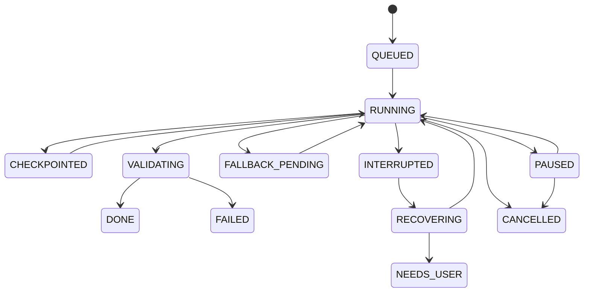

# PSEE — AI Fallback and Recovery Specification

**Document ID:** PSEE-AI-REC-004  
**Version:** 1.0.0  
**Status:** Draft for implementation  
**Last updated:** 2026-11-02

## 1. Purpose

Ensure that provider failures, interrupted responses, process crashes, and partial workspace changes do not silently destroy task progress or cause unsafe duplicate actions.

## 2. Failure categories

| Category | Example | Default action |
|---|---|---|
| Rate limit | HTTP 429 | Respect retry-after; then eligible fallback |
| Transient provider | 500/502/503 | Bounded retry with backoff; then fallback |
| Timeout | Request deadline exceeded | Determine whether request/action may have completed before retry |
| Network | Connection refused/reset | Check gateway/local adapter; then fallback |
| Authentication | 401 | Mark connection unauthorized; do not loop retries |
| Permission | 403 | Stop and request configuration/permission review |
| Model missing | 404 | Disable exact model mapping pending correction |
| Invalid request | 400/422 | Fix request/adapter; do not switch blindly |
| Content/policy refusal | Provider refusal | Do not bypass by routing to another provider |
| Invalid output | Malformed/empty response | One bounded repair attempt if safe; otherwise fail |
| Tool failure | Shell/test/editor action failed | Record tool result; do not assume model failure |

## 3. Retry rules

- Retries are bounded and configurable.
- Use exponential backoff with jitter for transient failures.
- Respect provider `Retry-After` when supplied.
- Do not retry authentication, permission, missing-model, or invalid-request errors without a configuration change.
- Do not retry non-idempotent tool actions until execution state is inspected.
- Provider-specific status codes must be normalized without discarding original sanitized details.

## 4. Fallback rules

Fallback is allowed only when:
- The error is classified as recoverable.
- The candidate model is eligible for the same task.
- Data policy permits the destination provider.
- The request can be safely replayed or reconstructed.
- The user has not paused or cancelled the task.

Fallback must preserve:
- Original task objective.
- Acceptance criteria.
- Relevant repository/workspace context.
- Last durable checkpoint.
- Prior attempts and known failure reason.
- Required output schema.

Do not blindly pass the entire prior chain-of-thought or hidden reasoning. Pass concise task state, decisions, artifacts, and explicit instructions.

## 5. Checkpoint model

A checkpoint is a durable record of task state. Minimum fields:
- task_id, run_id, checkpoint_id;
- created_at;
- repository/workspace identifier;
- branch and commit SHA;
- dirty-worktree summary;
- task status and current step;
- completed subtasks;
- pending subtasks;
- changed file list;
- test results;
- artifact references;
- selected provider/model;
- recovery notes.

Checkpoint triggers:
1. Before any workspace mutation.
2. After each independently completed subtask.
3. After a file-edit batch.
4. After tests and validation.
5. Before handing work to another Agent.
6. Before pausing or declaring completion.

## 6. Interrupted coding recovery

When a coding request times out or a process stops:
1. Mark run `INTERRUPTED` or `UNKNOWN_OUTCOME`.
2. Do not immediately replay the coding prompt.
3. Inspect workspace and Git status.
4. Compare current diff against the last checkpoint.
5. Determine whether the requested change was partially or fully applied.
6. Run safe, relevant tests if permitted.
7. Update checkpoint with observed state.
8. Resume from the next incomplete step or request user review.

## 7. Task state machine

`DONE` requires acceptance criteria and required validation to pass. A model response alone cannot transition a task to `DONE`.

## 8. Idempotency and duplicate prevention

- Every task action has an action ID and idempotency key where supported.
- Before repeating a tool call, query its prior execution record.
- File writes should be deterministic where possible.
- Git operations must inspect current state before retry.
- External side effects require explicit confirmation unless a policy expressly allows them.

## 9. Human controls

User can:
- Pause/resume a task.
- Cancel a task.
- Approve a provider change when required.
- Review diff before commit.
- Approve destructive or external side effects.
- Choose manual recovery if state is ambiguous.

## 10. Acceptance criteria

- [ ] Transient failures use bounded retries.
- [ ] 401/403/404/invalid request do not cause infinite fallback loops.
- [ ] Interrupted coding runs inspect workspace before replay.
- [ ] Checkpoints survive process restart.
- [ ] Recovery can resume from the last durable state.
- [ ] Duplicate non-idempotent actions are prevented.
- [ ] User pause/cancel is respected.
- [ ] Completion requires validation.
