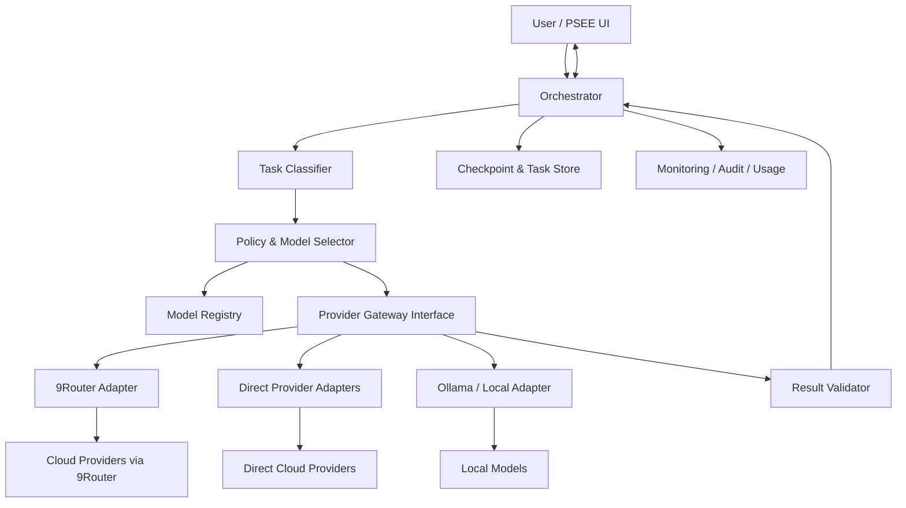

# PSEE — AI Infrastructure Architecture

**Document ID:** PSEE-AI-ARCH-001  
**Version:** 1.0.0  
**Status:** Draft for implementation  
**Last updated:** 2026-11-02  
**Language:** Indonesian

## 1. Tujuan

Dokumen ini menetapkan arsitektur infrastruktur AI untuk PSEE (Personal System Execution Environment). PSEE mengorkestrasi pekerjaan multi-agent, memilih model berdasarkan kebijakan, memantau eksekusi, dan memulihkan pekerjaan dari checkpoint.

Dokumen ini adalah spesifikasi target. Ia tidak menyatakan bahwa seluruh integrasi telah selesai atau telah lulus pengujian.

## 2. Prinsip arsitektur

1. **Provider-agnostic:** logika Agent tidak boleh terikat pada satu vendor atau satu gateway.
2. **Hybrid connectivity:** dukung 9Router gateway, direct provider adapter, dan local provider adapter.
3. **Policy-driven routing:** pemilihan model dilakukan berdasarkan kemampuan, status kesehatan, batas penggunaan, kebijakan biaya, dan persetujuan.
4. **Observable by default:** setiap eksekusi memiliki correlation ID dan catatan status.
5. **Recoverable execution:** pekerjaan yang mengubah workspace harus memiliki checkpoint dan prosedur pemulihan.
6. **Human control:** pengguna dapat menyetujui, menghentikan, melanjutkan, atau membatalkan pekerjaan.
7. **Least privilege:** Agent hanya memperoleh akses yang diperlukan untuk tugasnya.
8. **No silent success:** respons model bukan bukti bahwa perubahan kode benar atau sudah tersimpan.

## 3. Ruang lingkup

Termasuk:
- Provider dan account registry.
- Model registry dan capability metadata.
- Provider adapters.
- Routing policy dan fallback.
- Agent orchestration.
- Usage, health, incident, dan audit monitoring.
- Checkpoint/recovery.
- Pengujian integrasi dan acceptance criteria.

Tidak termasuk dalam v1.0:
- Jaminan rotasi akun lintas identitas untuk menghindari limit.
- Bypass autentikasi, paywall, rate limit, atau ketentuan provider.
- Pengelolaan kredensial akun secara otomatis di luar mekanisme resmi.
- Klaim dukungan API yang belum diverifikasi.
- Eksekusi perubahan produksi tanpa persetujuan yang sesuai.

## 4. Logical architecture

### 4.1 Control plane
- PSEE UI and API.
- Agent Orchestrator.
- Task classifier.
- Model Registry.
- Routing policy engine.
- Approval and permission service.
- Monitoring and audit service.

### 4.2 Execution plane
- Provider adapters.
- Model request execution.
- Agent tools (workspace, terminal, Git, tests).
- Result validation.
- Checkpoint/recovery workers.

### 4.3 Data plane
- Relational database for configuration and execution metadata.
- Secure secret store for credentials.
- Workspace files and Git repository for code artifacts.
- Optional local model runtime (Ollama).

## 5. Provider connectivity modes

### 5.1 9Router gateway mode
PSEE sends requests to a locally configured 9Router-compatible endpoint. The exact base URL, API path, authentication header, model naming convention, supported request format, and streaming behavior MUST be obtained from the installed 9Router version's UI/documentation or a successful controlled test.

Do not hardcode an assumed endpoint or assume every provider shown in the UI is API-compatible.

Configuration placeholders:
- `PSEE_9ROUTER_BASE_URL`
- `PSEE_9ROUTER_API_KEY`
- `PSEE_9ROUTER_DEFAULT_TIMEOUT_MS`
- `PSEE_9ROUTER_ENABLED`

These are names proposed for PSEE configuration, not verified 9Router-native setting names.

### 5.2 Direct provider mode
A direct adapter may be enabled only when:
- Official provider API access is available to the user.
- The correct API endpoint and authentication method are documented.
- The account's terms permit the intended use.
- A connectivity and capability test passes.

OAuth-based IDE subscriptions must not be treated as generic API keys. Do not extract browser or IDE session tokens to simulate direct API access.

### 5.3 Local provider mode
Ollama is a candidate local adapter. It remains `UNKNOWN` until a local health check, model inventory, and generation test pass. Local execution should report hardware constraints, context limits, model identifier, and runtime errors.

## 6. Request lifecycle

1. User creates or approves a task.
2. Orchestrator validates task scope, permissions, and workspace.
3. Task classifier identifies task type and requirements.
4. Policy engine queries eligible models from Model Registry.
5. Router selects a model and provider adapter.
6. Adapter submits request with task/run correlation metadata.
7. Response is normalized into a provider-neutral format.
8. Result validator checks structure and required outputs.
9. Agent tool actions are separately permission-checked.
10. Checkpoint and execution events are persisted.
11. UI displays outcome, provider/model, usage if available, and any uncertainty.

## 7. Multi-agent orchestration

Initial logical roles:
- Planner: decomposes a user goal into tasks and dependencies.
- Architect: proposes system design and interfaces.
- Researcher: gathers information from permitted sources.
- Coder: edits files within an assigned scope.
- Tester: executes approved tests and reports results.
- Reviewer: inspects changes and risks.
- Documentation Agent: maintains technical documentation.

Agents are roles, not necessarily separate model instances. The same model may serve multiple roles if policy permits. Parallel execution is allowed only for independent tasks with non-overlapping write scopes.

## 8. Workspace and Git safety

- Each run records repository, branch, commit SHA, and dirty-worktree status at start.
- Destructive operations require explicit approval.
- Coder agents should work in a task branch or isolated worktree where feasible.
- Never automatically force-push, rewrite shared history, or delete user changes.
- Before retrying an interrupted coding task, inspect Git diff and workspace state.
- A task is not `DONE` until acceptance criteria and required tests pass.

## 9. Availability and degraded operation

If 9Router is unavailable:
- PSEE control plane and task history remain available.
- Use a direct adapter only if explicitly configured and verified.
- Use Ollama only if its adapter and selected model have passed tests.
- Otherwise queue or pause the task and request user action.

PSEE must not silently claim that fallback occurred if no alternative completed successfully.

## 10. Security boundaries

- Secrets are stored outside source control.
- Logs redact credentials and sensitive prompt content according to policy.
- Provider account identifiers are internal references; avoid displaying full email addresses unnecessarily.
- Tool permissions are scoped per task and Agent.
- External content is untrusted input and cannot override system policy.
- Admin actions, credential changes, and policy changes are audited.

## 11. Non-functional requirements

- Recoverable task state.
- Explicit timeouts and bounded retries.
- Structured logs with correlation IDs.
- Configurable concurrency limits.
- Clear UI status for queued/running/paused/failed/recovered tasks.
- No dependency on one provider for core PSEE data access.
- Database migrations are versioned and reversible where practical.

## 12. Architecture decisions

| ID | Decision | Status |
|---|---|---|
| ADR-AI-001 | PSEE owns orchestration; 9Router is a provider gateway, not the orchestrator | Accepted |
| ADR-AI-002 | Support gateway, direct, and local adapter types | Accepted as target |
| ADR-AI-003 | No global Round Robin as the initial routing strategy | Accepted |
| ADR-AI-004 | Model eligibility is controlled by registry status and policy | Accepted |
| ADR-AI-005 | Checkpoint before/after meaningful workspace mutations | Accepted |
| ADR-AI-006 | Antigravity excluded from production routing pending diagnosis | Provisional |

## 13. Acceptance criteria

- [ ] PSEE can start and track a task without a provider being available.
- [ ] Provider adapters are replaceable without changing Agent business logic.
- [ ] Gateway endpoint and auth are configurable, not hardcoded.
- [ ] A verified local adapter can be selected independently of 9Router.
- [ ] Each run records selected provider/model and adapter mode.
- [ ] Provider outage does not erase tasks or checkpoints.
- [ ] User can pause/cancel execution.
- [ ] No secret is committed to Git or written to ordinary logs.
- [ ] Documentation and implementation distinguish verified facts from assumptions.
