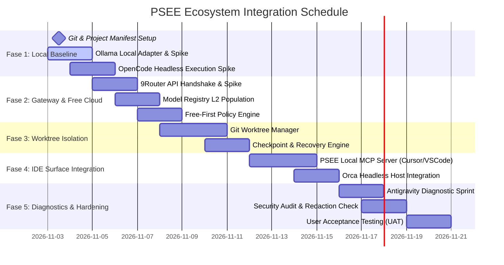

# PSEE — Ecosystem Integration Roadmap & Execution Plan

**Document ID:** PSEE-ROAD-007  
**Version:** 1.0.0  
**Status:** Approved Strategic Roadmap  
**Date:** 2026-11-02  
**Scope:** Integration Milestones, Deliverables, Dependencies, & Rollback Controls

---

## 1. Roadmap Overview & Timeline

Roadmap ini merinci tahapan integrasi bertahap untuk menghubungkan seluruh alat, IDE, CLI, dan provider yang terpasang di Mac pengguna ke dalam arsitektur PSEE:

---

## 2. Rincian Fase Integrasi

### Fase 1: Local Baseline & OpenCode Headless Runner
- **Durasi:** Hari 1–3
- **Prasyarat:** Node.js v24, Git, dan binary `/usr/local/bin/ollama`, `/usr/local/bin/opencode`.
- **Target Output:**
  - Repositori diinisialisasi dengan Git (`git init`) dan `.gitignore` komprehensif.
  - Skrip pengujian koneksi ke Ollama (`http://127.0.0.1:11434/api/tags`) memverifikasi model lokal (misal: `qwen2.5-coder:7b`).
  - `OpenCodeBridgeAdapter` berhasil menjalankan 1 tugas membuat file di folder `/tmp` terisolasi dengan exit code 0.
- **Kriteria Lolos:** PSEE dapat memerintahkan OpenCode melakukan pengeditan file lokal tanpa network eksternal.
- **Rencana Rollback:** Jika OpenCode gagal dijalankan secara headless, gunakan adapter eksekusi file mandiri via Node.js script.

### Fase 2: 9Router Gateway & Free Cloud Integration
- **Durasi:** Hari 4–7
- **Prasyarat:** 9Router Proxy aktif pada host.
- **Target Output:**
  - Verifikasi port API aktual 9Router dan header otorisasi.
  - Uji inferensi minimal pada model Kilo Free (`kc/kilo-auto/free`) dan Gemini Free.
  - Implementasi tabel `ai_models` dan `model_capabilities` di SQLite lokal; catat model yang lulus sebagai `CONNECTIVITY_VERIFIED`.
  - Aktifkan aturan Free-First: jika model lokal tidak mampu, alihkan ke model gratis gateway.
- **Kriteria Lolos:** 1 tugas perencanaan arsitektur berhasil dieksekusi melalui Gemini Free via 9Router.
- **Rencana Rollback:** Jika 9Router tidak stabil, alihkan rute perencanaan ke direct Google AI Studio API key resmi.

### Fase 3: Git Worktree Isolation & Checkpoint Engine
- **Durasi:** Hari 8–11
- **Prasyarat:** Fase 1 dan Fase 2 selesai.
- **Target Output:**
  - `WorktreeManager` otomatis membuat `.psee/worktrees/task-<id>` untuk setiap tugas coding baru.
  - `CheckpointEngine` menyimpan snapshot Git status sebelum dan sesudah agent menulis file.
  - Uji coba simulasi penghentian mendadak (*process kill*): sistem berhasil memulihkan state dari checkpoint terakhir.
- **Kriteria Lolos:** File di main working branch tetap bersih 100% selama agent coding bekerja.
- **Rencana Rollback:** Hapus direktori worktree yang bermasalah dengan `git worktree remove --force`.

### Fase 4: IDE Surface Integration (MCP Server untuk Cursor & VS Code)
- **Durasi:** Hari 12–15
- **Prasyarat:** Fase 3 selesai.
- **Target Output:**
  - PSEE meluncurkan MCP Server lokal (`psee mcp`).
  - Cursor dan VS Code dapat membaca daftar task aktif, melihat git diff antar checkpoint, dan menyetujui penggabungan branch.
  - Hubungkan `orca serve` sebagai alternatif host koordinasi agent.
- **Kriteria Lolos:** Pengembang dapat meninjau dan menyetujui hasil coding agent langsung dari panel Cursor / VS Code.
- **Rencana Rollback:** Tetap gunakan terminal CLI PSEE sebagai antarmuka fallback jika MCP server mengalami kendala.

### Fase 5: Antigravity Diagnostic & Security Hardening
- **Durasi:** Hari 16–20
- **Prasyarat:** Fase 4 selesai.
- **Target Output:**
  - Jalankan serangkaian pengujian diagnostik terisolasi untuk mengidentifikasi penyebab kegagalan Antigravity (apakah port, auth header, format URL, atau timeout).
  - Tentukan apakah Antigravity dapat dipulihkan dari status `QUARANTINED` atau tetap diisolasi.
  - Pengujian redaksi keamanan: 100% string secret disaring dari file log.
  - User Acceptance Testing (UAT) menyeluruh dengan proyek nyata.
- **Kriteria Lolos:** Seluruh 5 Release Gates (Gate A s/d E) lulus verifikasi tanpa catatan kegagalan kritis.

