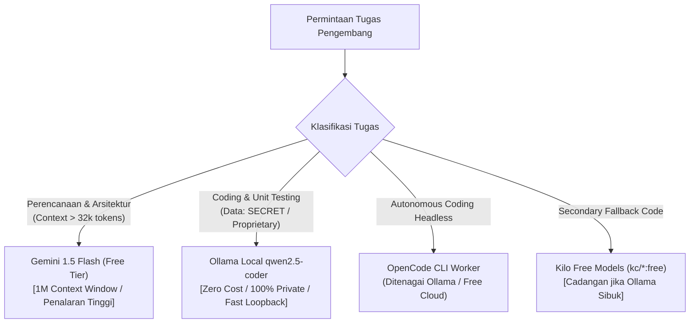

# PSEE — Free AI Model Provider Catalog & Limits Specification

**Document ID:** PSEE-CAT-005  
**Version:** 1.0.0  
**Status:** Approved Catalog Specification  
**Date:** 2026-11-02  
**Scope:** Legitimate Free AI Models, Quota Caps, Privacy Policies, & Registry State

---

## 1. Master Model Catalog (Free-Tier & Local Compute)

Tabel berikut mencantumkan seluruh model yang dapat diakses secara gratis dan sah di lingkungan PSEE:

| Canonical Model ID | Provider & Kanal | Konteks Window | Limit Resmi (RPM / RPD) | Biaya Finansial ($/1M token) | Kebijakan Privasi Data | Status Registri PSEE |
|---|---|---|---|---|---|---|
| `ollama/qwen2.5-coder:7b` | Ollama Local | 32.768 | $\infty$ (Hardware Bound) | **$0.00** | **100% Private (Local)** | `INSTALLED` / `NEEDS_VERIFICATION` |
| `ollama/qwen2.5-coder:3b` | Ollama Local | 32.768 | $\infty$ (Hardware Bound) | **$0.00** | **100% Private (Local)** | `INSTALLED` / `NEEDS_VERIFICATION` |
| `gemini-1.5-flash` | Google AI Studio (Direct/9Router) | 1.048.576 | 15 RPM / 1.500 RPD | **$0.00** (Free Tier) | *Logged for model training* | `PARTIAL` (Candidate L1) |
| `gemini-1.5-flash-8b` | Google AI Studio (Direct/9Router) | 1.048.576 | 15 RPM / 1.500 RPD | **$0.00** (Free Tier) | *Logged for model training* | `PARTIAL` (Candidate L1) |
| `kc/kilo-auto/free` | Kilo (via 9Router) | 32.768 | Dinamis (Sponsored) | **$0.00** | Tergantung host upstream | `PARTIAL` (Candidate L0) |
| `kc/nvidia/nemotron-3.5-lightning:free` | Kilo (via 9Router) | 65.536 | Dinamis (Sponsored) | **$0.00** | Tergantung host upstream | `PARTIAL` (Candidate L0) |
| `kc/cohere/north-mini-code:free` | Kilo (via 9Router) | 32.768 | Dinamis (Sponsored) | **$0.00** | Tergantung host upstream | `PARTIAL` (Candidate L0) |
| `kc/dots-studio/dots-3-note-preview:free`| Kilo (via 9Router) | 16.384 | Dinamis (Sponsored) | **$0.00** | Tergantung host upstream | `PARTIAL` (Candidate L0) |
| `openrouter/free` | OpenRouter (via 9Router) | Bervariasi | Bervariasi per model | **$0.00** | Tergantung model open | `PARTIAL` (Candidate L0) |
| `cx/gpt-5.6-terra` | OpenAI Codex (via 9Router) | 128.000 | Terikat kuota akun proxy | In-quota | Upstream OpenAI policy | `PARTIAL` (Candidate L0) |
| `cx/gpt-6-luna` | OpenAI Codex (via 9Router) | 128.000 | Terikat kuota akun proxy | In-quota | Upstream OpenAI policy | `PARTIAL` (Candidate L0) |

---

## 2. Model yang Dikarantina & Dikeluarkan dari Routing Otomatis

| Model / Provider | Alasan Teknis Pengecualian | Status Registri | Tindakan PSEE |
|---|---|---|---|
| **Antigravity Models** (via 9Router) | 100% model yang diuji sebelumnya mengalami kegagalan (timeout / 404 not found / error komunikasi). | `QUARANTINED` | Dikeluarkan secara mutlak dari routing otomatis sampai pengujian diagnosis terkontrol berhasil. |
| **Claude 3.5 Sonnet / Opus** (via `claude` CLI) | Tidak memiliki free-tier resmi; memerlukan pembayaran per token (pay-as-you-go). | `NOT_CONFIGURED` (Paid) | Dinonaktifkan secara default; hanya aktif dengan otorisasi eksplisit via Human Approval Gate. |
| **DeepSeek API Direct** | Memerlukan saldo kredit aktif di platform DeepSeek. | `NOT_CONFIGURED` | Tidak diaktifkan dalam rute v1.0. |

---

## 3. Strategi Pembagian Beban Tugas (Workload Mapping)

### 3.1 Tugas Perencanaan (Planning & Architecture)
- **Model Utama:** `gemini-1.5-flash` (atau Gemini Flash via 9Router).
- **Rasional:** Tugas dekomposisi kebutuhan memerlukan pemahaman repositori yang luas (jendela konteks besar) dan penalaran logika yang kuat. Batas 15 RPM sangat mencukupi karena perencanaan hanya berjalan 1-2 kali per siklus kerja.

### 3.2 Tugas Penulisan Kode (Coding & Implementation)
- **Model Utama:** `ollama/qwen2.5-coder:7b` (atau `3b` untuk mesin RAM terbatas).
- **Rasional:** Eksekusi kode dilakukan berulang kali (*high-frequency edits*). Menjalankannya di mesin lokal menghilangkan risiko terkena rate limit, bebas latensi jaringan, dan menjamin kode tidak meninggalkan perangkat.

### 3.3 Tugas Review Kode & Security Diff
- **Model Utama:** `gemini-1.5-flash` atau Model Evaluator Kilo Free.
- **Rasional:** Menilai kualitas `git diff` membutuhkan pemahaman *clean code* dan deteksi celah keamanan tanpa memodifikasi file.

