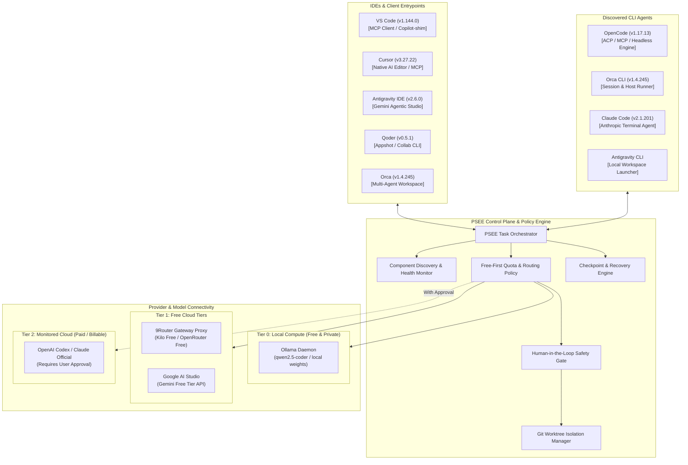

# PSEE — Maximum Free AI Ecosystem Architecture

**Document ID:** PSEE-ECO-001  
**Version:** 1.0.0  
**Status:** Approved Architectural Blueprint  
**Date:** 2026-11-02  
**Scope:** macOS Multi-Agent & Free AI Tooling Orchestration

---

## 1. Executive Summary & Vision

Platform PSEE (*Personal System Execution Environment*) dirancang untuk memaksimalkan seluruh ekosistem AI coding yang tersedia secara sah dan bebas biaya di mesin macOS pengguna. PSEE tidak membatasi diri pada satu penyedia (vendor-agnostic), tidak bergantung pada satu IDE, dan menolak penguncian platform (*zero vendor lock-in*).

Melalui audit penemuan (*discovery audit*) lingkungan macOS aktual, ditemukan aset terpasang yang jauh lebih kaya dari perkiraan awal:
- **7 Lingkungan Pengembangan & IDE:** Visual Studio Code (v1.144.0), Cursor (v3.27.22), Antigravity IDE (v2.6.0), Antigravity macOS Client (v2.28.2), Qoder (v0.5.1), Orca Studio (v1.4.245), dan Android Studio.
- **4 CLI AI Agents:** OpenCode CLI (v1.17.13), Orca CLI (v1.4.245), Claude Code CLI (v2.1.201), dan Antigravity IDE CLI launcher (`antigravity-ide`).
- **Local Inference Engines:** Ollama runtime (v0.31.1 di `/Applications/Ollama.app` dan `/usr/local/bin/ollama`).
- **AI Gateways & Aggregators:** 9Router Proxy v0.5.112 (loopback port 20128).

Tujuan utama arsitektur ini adalah membangun sistem orkestrasian multi-agent yang mengombinasikan keunggulan masing-masing alat secara sinergis, memprioritaskan biaya marjinal nol (*Free-First*), mengisolasi perubahan kode dengan Git Worktree, serta mencegah agent melakukan tindakan destruktif tanpa persetujuan eksplisit.

---

## 2. PSEE Ecosystem Architecture Blueprint

---

## 3. Prinsip Tata Kelola Ekosistem (Core Principles)

1. **Free-First Hierarchy:**
   - **Tingkat 0 (Nol Biaya & Privat):** Model lokal via Ollama (`127.0.0.1:11434`).
   - **Tingkat 1 (Free Cloud Tiers):** Google AI Studio Gemini Free (15 RPM / 1.500 RPD), Kilo Free models (`kc/*:free`), dan OpenRouter free endpoints via 9Router.
   - **Tingkat 2 (Entitlement / Subscriptions):** Sesi pengguna yang sudah aktif (misal: Cursor Composer gratis bulanan, kuota OpenCode bawaan).
   - **Tingkat 3 (Paid API):** Model komersial berbayar (OpenAI API direct, Claude API pay-per-token). **Terkunci secara default**; wajib persetujuan manusia.
2. **Kepatuhan Terms of Service (No Scraping / No Token Theft):**
   - PSEE tidak mengekstrak token sesi OAuth rahasia dari browser atau file internal IDE.
   - PSEE berkomunikasi melalui protokol resmi yang didukung: CLI execution flags, ACP (*Agent Client Protocol*), MCP (*Model Context Protocol*), atau REST API terstandarisasi.
3. **Workspace Isolation via Git Worktrees:**
   - Direktori kerja pengguna tidak boleh disentuh langsung oleh agent. Seluruh eksekusi coding berlangsung di `.psee/worktrees/task-<id>/`.
4. **Honest Metric Accounting:**
   - Kuota atau biaya yang tidak dikembalikan secara pasti oleh provider dicatat sebagai `UNKNOWN`, dilarang dicatat sebagai `0` atau gratis tak terbatas.

---

## 4. Taksonomi Komponen & Status Verifikasi

Mengikuti standar verifikasi ketat PSEE:
- `DISCOVERED`: Tercantum dalam konfigurasi atau referensi, belum dicek fisik.
- `INSTALLED`: Binary atau file `.app` fisik terbukti ada di path sistem.
- `VERSION_VERIFIED`: Versi berhasil diekstrak melalui flag `--version` atau `Info.plist`.
- `CONNECTIVITY_VERIFIED`: PSEE berhasil melakukan handshake / ping ke daemon/runtime.
- `EXECUTION_VERIFIED`: PSEE berhasil menyelesaikan 1 tugas terkontrol melalui komponen tersebut.
- `ERROR`: Gagal dijalankan atau mengalami timeout/karantina.

