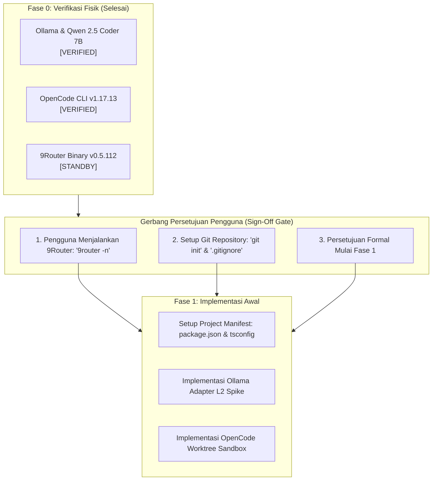

# PSEE — Phase 0: Implementation Readiness & Go/No-Go Decision Report

**Document ID:** PSEE-READY-P0-003  
**Version:** 1.0.0  
**Status:** Awaiting User Sign-Off (Go/No-Go Decision)  
**Date:** 2026-11-03  
**Auditor:** Senior AI Infrastructure Engineer & macOS Environment Auditor

---

## 1. Executive Verdict: CONDITIONAL GO (Menunggu Persetujuan Pengguna)

Berdasarkan pengujian empiris pada lingkungan macOS pengguna:

| Aspek Evaluasi | Kesiapan (*Readiness*) | Catatan Utama Auditor |
|---|---|---|
| **Komputasi Lokal (Ollama)** | 🟢 **100% READY** | Daemon aktif pada socket `127.0.0.1:11434`. Model `qwen2.5-coder:7b` (4.7 GB) telah terpasang fisik di disk dan siap dipakai tanpa unduhan tambahan. |
| **Agent CLI (OpenCode)** | 🟢 **90% READY** | Binary v1.17.13 siap di `/usr/local/bin/opencode`. Menawarkan 4 model cloud gratis bawaan. Memerlukan argumen OpenAI-compatible untuk memanggil Ollama. |
| **Gateway Cloud (9Router)** | 🟡 **STANDBY / OFFLINE** | Binary v0.5.112 terpasang. Port 20128 saat ini offline karena daemon belum dijalankan oleh pengguna. |
| **Version Control & Sandboxing** | 🔴 **ACTION REQUIRED** | Repositori belum diinisialisasi Git. Dibutuhkan `git init` dan pembuatan `.gitignore`. |
| **Keamanan & Redaksi Secret** | 🟢 **100% READY** | Kebijakan proteksi secret dan isolasi worktree siap diterapkan. |

**Keputusan Auditor:**  
Status kesiapan sistem adalah **CONDITIONAL GO**. Fondasi komputasi lokal dan agent execution sudah sangat kokoh, namun implementasi Fase 1 **tidak boleh dimulai** sebelum pengguna menyetujui hasil verifikasi ini dan menyelesaikan 2 langkah inisialisasi awal.

---

## 2. Peta Transisi Fase 0 ke Fase 1



---

## 3. Langkah Transisi yang Diperlukan Sebelum Fase 1 Dimulai

Untuk melangkah ke Fase 1 (Implementasi Kode dan Project Scaffolding), terdapat 2 tindakan cepat yang perlu diselesaikan:

1. **Jalankan Daemon 9Router (oleh Pengguna):**
   - Buka tab terminal baru pada Mac dan jalankan:
     ```bash
     9router -n
     ```
   - Tindakan ini akan mengaktifkan port 20128 di background dan membuka akses ke model cloud gratis Kilo/OpenRouter serta model Codex upstream.
2. **Inisialisasi Git & Proteksi File (oleh Sistem setelah persetujuan pengguna):**
   - Membuat file `.gitignore` standar PSEE.
   - Menjalankan `git init` di `/Users/jofi/Documents/PROJECT/PSEE`.
   - Melakukan commit awal (*initial commit*) yang mengunci seluruh dokumen arsitektur dan hasil audit ke dalam branch `main`.

---

## 4. Pernyataan Penutup Auditor

> [!IMPORTANT]
> Sesuai instruksi ketat audit: **"Do not begin Phase 1 until the user explicitly approves the verification results."**
> 
> Tidak ada file implementasi atau kode aplikasi yang dibuat dalam sesi ini. Seluruh temuan telah dibukukan secara objektif dan transparan dalam dokumen audit Fase 0.

