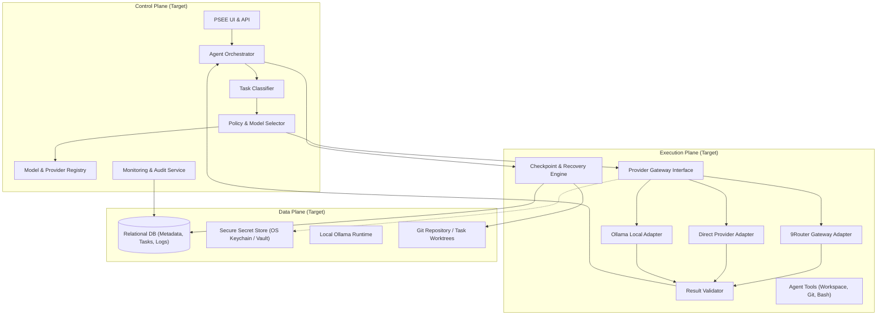
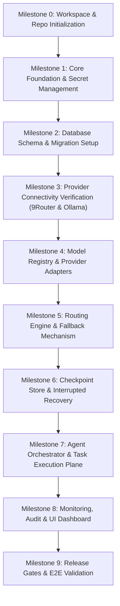

# PSEE — M1 Environment & Architecture Audit Report

**Document ID:** PSEE-AUDIT-M1-001  
**Version:** 1.0.0  
**Date:** 2026-11-02  
**Audit Scope:** Repository `/Users/jofi/Documents/PROJECT/PSEE` & PSEE AI Infrastructure v1.0 Documentation Pack  
**Auditor:** Antigravity Engineering System Audit  
**Status:** COMPLETE (Read-Only Audit Phase)

---

## 1. Executive Summary

Audit ini dilakukan terhadap repositori PSEE (Personal System Execution Environment) sebelum fase implementasi teknis dimulai. Audit mencakup inspeksi menyeluruh terhadap struktur direktori aktual, runtime host lokal, status database, autentikasi, orkestrasian agent, integrasi provider AI, monitoring, logging, checkpointing, serta verifikasi silang terhadap 8 dokumen spesifikasi resmi *PSEE AI Infrastructure v1.0*.

**Temuan Utama:**
- **Status Repositori:** Proyek saat ini berada pada tahap **Day-0 / Green-field Architecture**. Belum terdapat kode sumber aplikasi (backend, frontend, database migration, orkestrator runtime, maupun test runner).
- **Aset yang Tersedia:** Repositori saat ini berisi 8 dokumen spesifikasi arsitektur AI Infrastructure v1.0 dan 1 README panduan di direktori `PSEE_AI_Infrastructure_v1.0/`, ditambah direktori kosong `.cursor/`. Repositori belum diinisialisasi Git (`.git` tidak ditemukan).
- **Runtime Host Lokal:** Mesin lokal (macOS Darwin) memiliki runtime dasar yang siap digunakan: Node.js (v24.16.0), Python (3.15.2), Git (2.50.1), dan binary Ollama (`/usr/local/bin/ollama`).
- **Tingkat Kesiapan Dokumen:** Spesifikasi v1.0 memiliki kualitas arsitektur tinggi dengan pemisahan yang sangat ketat dan disiplin antara "klaim observasi pengguna" (*user-reported*) dengan "hasil verifikasi PSEE" (*PSEE-verified*).
- **Kesiapan Implementasi (*Readiness*):** **PARTIALLY READY**. Fondasi konseptual, model data, policy routing, dan testing strategy sudah sangat matang di level dokumen, namun membutuhkan penyiapan infrastruktur dasar (scaffolding proyek, git init, setup database SQLite/PostgreSQL, secret store adapter, dan verifikasi endpoint 9Router) sebelum implementasi logika agent dapat berjalan.

---

## 2. Existing Architecture

Secara aktual di repositori, belum ada arsitektur perangkat lunak yang terpasang (*no running code*). Berdasarkan dokumen `AI_INFRASTRUCTURE_ARCHITECTURE.md`, target arsitektur yang direncanakan mengusung pola **Decoupled Three-Plane System**:

### Kondisi Realitas Saat Audit
1. **Control Plane:** Belum terimplementasi. Belum ada process manager, express/fastapi server, atau agent coordinator.
2. **Execution Plane:** Belum ada adapter jaringan, client HTTP/SSE, wrapper execution, maupun runner sandboxing.
3. **Data Plane:** Database schema masih berupa dokumen DDL logis. Tidak ada file database (`.sqlite`, `.db`) maupun koneksi database yang aktif.
4. **Workspace State:** Belum ada inisialisasi version control Git (`fatal: not a git repository`).

---

## 3. Technology Stack

### 3.1 Host Environment (Terdeteksi di Mesin)
| Komponen | Status Terdeteksi | Lokasi / Versi | Catatan |
|---|---|---|---|
| OS | IMPLEMENTED | macOS (Darwin) | Platform kerja lokal |
| Node.js | IMPLEMENTED | `/usr/local/bin/node` (v24.16.0) | Cocok untuk Control Plane / TypeScript backend / Next.js / Vite |
| npm | IMPLEMENTED | `/usr/local/bin/npm` (11.13.0) | Package manager aktif |
| Python | IMPLEMENTED | `/Library/Frameworks/.../python3` (3.15.2) | Python runtime aktif untuk tooling / ML / script |
| Git | IMPLEMENTED | `/usr/bin/git` (Apple Git-155, v2.50.1) | Git CLI tersedia, tetapi repo belum `git init` |
| Ollama | IMPLEMENTED | `/usr/local/bin/ollama` | Binary terpasang; koneksi daemon belum diverifikasi |
| 9Router Proxy | NEEDS_VERIFICATION | Host port 20128 (Dashboard) | Terpasang secara eksternal menurut laporan user (v0.5.112); endpoint API belum diuji |

### 3.2 Target Application Stack (Berdasarkan Spesifikasi Dokumen)
- **Bahasa Utama:** TypeScript / Node.js (direkomendasikan untuk Adapter Interface dan UI) atau Python (didukung untuk skrip orkestrasi).
- **Database:** Relasional (SQLite dengan WAL mode untuk single-user lokal atau PostgreSQL).
- **ORM / Query Tool:** Belum dipilih secara definitif dalam dokumen (Drizzle / Prisma / Kysely atau SQLAlchemy).
- **Secret Management:** OS Keychain / Encrypted Store terisolasi (bukan file plain text di database atau repo).
- **Gateway AI:** 9Router Proxy (v0.5.112) sebagai gateway multi-provider lokal.
- **Local AI:** Ollama local daemon.

---

## 4. Existing Features & Documentation Assets

Repositori saat ini memiliki aset dokumentasi lengkap di `PSEE_AI_Infrastructure_v1.0/`:

1. **`README.md`**: Ringkasan paket dokumentasi, panduan status observasi, dan rekomendasi urutan implementasi 7 langkah.
2. **`AI_INFRASTRUCTURE_ARCHITECTURE.md` (PSEE-AI-ARCH-001)**: Arsitektur logis, prinsip *provider-agnostic*, pembagian control/execution/data plane, siklus hidup task, peran multi-agent, dan *workspace Git safety*.
3. **`AI_MODEL_REGISTRY_SPEC.md` (PSEE-AI-MREG-002)**: Spesifikasi catalog model, pembedaan L0–L4 evidence, penanganan 10 candidate OpenAI IDs, 4 candidate Gemini IDs, 11 candidate Kilo IDs, karantina Antigravity, serta skema kontrak API model.
4. **`AI_ROUTING_POLICY.md` (PSEE-AI-ROUTE-003)**: Kebijakan seleksi model berbasis kapabilitas, kelas task (Planning, Coding, Review, dsb.), klasifikasi sensitivitas data (PUBLIC s/d SECRET), larangan global round-robin, dan explainability audit.
5. **`AI_FALLBACK_AND_RECOVERY.md` (PSEE-AI-REC-004)**: Taksonomi kegagalan (429, 5xx, timeout, 401, 403, 404), batasan retry/backoff, model data checkpoint, state machine 12-state, dan protokol *Interrupted Coding Recovery*.
6. **`AI_PROVIDER_INTEGRATION.md` (PSEE-AI-PROV-005)**: Interface TypeScript `ProviderAdapter`, `NormalizedRequest`, `NormalizedResponse`, `NormalizedErrorCode`, prasyarat verifikasi endpoint 9Router, adapter direct, dan adapter Ollama.
7. **`AI_MONITORING_SPEC.md` (PSEE-AI-MON-006)**: Desain 9 seksi dashboard observabilitas, metrik latensi/keberhasilan/biaya, event schema JSON dengan *correlation ID*, serta aturan penanganan kuota/token "Unknown vs 0".
8. **`AI_DATABASE_SCHEMA.md` (PSEE-AI-DB-007)**: Spesifikasi ERD 16 tabel, foreign key, index performa, aturan enkripsi kredensial di luar database, dan strategi migrasi.
9. **`AI_TESTING_STRATEGY.md` (PSEE-AI-TEST-008)**: 5 level bukti (L0–L4), suite pengujian provider, model benchmark, routing/fallback, recovery, isolasi security/prompt-injection, dan 5 release gates (Gate A–E).

---

## 5. Component Status Breakdown

Status evaluasi seluruh komponen sesuai taksonomi:
- `IMPLEMENTED`: Sudah ada dan terverifikasi di kode/lingkungan.
- `PARTIAL`: Sudah ada sebagian, atau baru berupa spesifikasi/observasi tanpa implementasi penuh.
- `MISSING`: Belum ada sama sekali.
- `NEEDS_VERIFICATION`: Perlu diuji dan divalidasi ke sistem aktual sebelum diasumsikan bekerja.

| Komponen / Modul | Status | Deskripsi & Lokasi |
|---|---|---|
| **Repository & VCS Setup** | `MISSING` | Tidak ada folder `.git`, tidak ada `.gitignore`. Repo belum diinisialisasi. |
| **Project Manifest & Dependencies** | `MISSING` | Tidak ada `package.json`, `tsconfig.json`, `pyproject.toml`, atau lockfile. |
| **Documentation Pack v1.0** | `IMPLEMENTED` | Lengkap 8 spesifikasi + 1 README di `PSEE_AI_Infrastructure_v1.0/`. |
| **Frontend UI / Dashboard** | `MISSING` | Belum ada dashboard web (9 section monitoring belum memiliki antarmuka pengguna). |
| **Backend API / Entry Point** | `MISSING` | Belum ada web server / REST / RPC / GraphQL service. |
| **Database Schema DDL & ORM** | `PARTIAL` | Desain konseptual 16 tabel selesai di `AI_DATABASE_SCHEMA.md`; implementasi DDL/migrasi/ORM `MISSING`. |
| **Secret Store / Credential Vault** | `MISSING` | Mekanisme pembacaan Keychain / KMS / `.env` terenkripsi belum dibuat. |
| **Provider Adapter Interface** | `PARTIAL` | Definisi interface `ProviderAdapter` ada di doc; class/kode implementasi `MISSING`. |
| **9Router Gateway Integration** | `NEEDS_VERIFICATION` | 9Router Proxy terpasang eksternal (laporan user), tetapi base URL, auth token header, dan inference route belum diuji. |
| **Ollama Local Adapter** | `NEEDS_VERIFICATION` | Binary terpasang di host (`/usr/local/bin/ollama`); daftar model aktif dan generation harness belum diverifikasi. |
| **OpenAI Codex Models via 9Router** | `PARTIAL` | 2 model dilaporkan lolos secara verbal, 10 model list terdaftar sebagai kandidat (L1); belum lolos verifikasi L2 PSEE. |
| **Gemini Models via 9Router** | `PARTIAL` | 4 label model dilaporkan lolos (L1); canonical model ID dan kestabilan belum diverifikasi (L2). |
| **Kilo Models via 9Router** | `PARTIAL` | 11 candidate model terdaftar; hasil parsial belum dipetakan per model ID. |
| **Antigravity Integration** | `PARTIAL` (Quarantined) | Dinyatakan berstatus `QUARANTINED` di doc karena kegagalan konsisten pada pengujian awal pengguna. |
| **Agent Orchestrator & Roles** | `PARTIAL` | Desain 7 role (Planner, Architect, Coder, dll.) terdokumentasi; runtime runner `MISSING`. |
| **Routing Policy Engine** | `PARTIAL` | Kebijakan scoring, capability match, data classification terdokumentasi; engine kalkulasi `MISSING`. |
| **Task Execution & Checkpoint Store** | `PARTIAL` | State machine & skema checkpoint terdokumentasi; serializer snapshot & git diff checker `MISSING`. |
| **Interrupted Coding Recovery** | `PARTIAL` | Aturan pemulihan workspace terdokumentasi; executor recovery `MISSING`. |
| **Monitoring & Structured Logger** | `PARTIAL` | Event schema & correlation ID terdokumentasi; logger collector & alert engine `MISSING`. |
| **Test Harness & Benchmark Runner**| `PARTIAL` | Rubrik benchmark & test suites terdokumentasi; skrip runner pengujian `MISSING`. |

---

## 6. Architecture Conflicts & Discrepancies

1. **Dashboard URL vs Inference Endpoint (9Router):**
   - Dokumen `AI_PROVIDER_INTEGRATION.md` mengingatkan bahwa URL dashboard 9Router (misal `http://localhost:20128`) belum tentu sama dengan URL endpoint inferensi OpenAI/Anthropic-compatible (misal `/v1/chat/completions` atau port yang berbeda).
   - *Conflict:* Ada potensi asumsi di awal bahwa port dashboard langsung dapat ditembak sebagai API backend model.
2. **Model Label vs Upstream Canonical ID:**
   - Label model Gemini yang dilaporkan user (`3.6 Flash`, `3.1 Flash-Lite Preview`, `3.5 Flash-Lite`, `3-Flash-Review`) bukan merupakan format ID standar API Google Cloud / Gemini resmi (seperti `gemini-1.5-flash-latest`, dsb.).
   - *Conflict:* Jika adapter mengirim string label mentah tersebut tanpa translasi atau mapping dari 9Router model catalog, gateway berpotensi mengembalikan `404 MODEL_NOT_FOUND`.
3. **No Global Round Robin vs Multi-Account Load Balancing:**
   - 9Router memiliki kapabilitas multi-akun dan UI Quota Tracker. Namun `AI_ROUTING_POLICY.md` secara eksplisit melarang Global Round Robin dan rotasi akun otomatis untuk membypass rate limit.
   - *Conflict:* Orkestrator PSEE harus memegang kendali routing dan hanya memanggil 9Router dengan model target spesifik, bukan membiarkan 9Router melakukan random load balancing yang tidak terpantau oleh PSEE.
4. **Synchronous Execution vs Long-Running Agent Tasks:**
   - Tugas coding dan testing multi-agent membutuhkan waktu menit hingga jam. Tanpa worker queue / process isolation (misal background daemon), server API berisiko mengalami HTTP timeout saat menunggu eksekusi agent selesai.

---

## 7. Security Risks

1. **Ketiadaan `.gitignore` & Risiko Kebocoran Kredensial:**
   - Belum adanya file `.gitignore` dapat menyebabkan file `.env`, file private key, database SQLite lokal, atau log prompt berisi data pribadi tidak sengaja ter-commit saat repositori diinisialisasi.
2. **Penyimpanan Kredensial Gateway / Direct Provider:**
   - Dokumen melarang keras penyimpanan raw API key di database relasional. Jika developer pemula langsung menyimpan `api_key` ke tabel `provider_connections`, hal ini melanggar kepatuhan keamanan ADR-AI-001.
3. **Eksekusi Workspace & Tool Permission Boundary:**
   - Role Coder dan Tester akan menjalankan tool bash, git commit, dan file write. Tanpa sandbox execution yang ketat, terdapat risiko modifikasi file di luar direktori workspace proyek atau eksekusi perintah destruktif (`rm -rf`, `git reset --hard`).
4. **Data Sensitivity Leakage:**
   - Sesuai `AI_ROUTING_POLICY.md`, data berkategori `SECRET` atau `CONFIDENTIAL` tidak boleh dikirim ke provider cloud eksternal. Belum ada sanitizer/filter yang memotong API key atau token rahasia sebelum request dikirim ke 9Router.

---

## 8. Technical Debt & Day-0 Risks

1. **Green-field Scaffolding Overhead:**
   - Karena belum ada kode sama sekali, seluruh boilerplate (TypeScript/Node/Python setup, linting, formatting, test framework, DB client, HTTP server) harus dibangun dari nol tanpa template yang sudah teruji di repo.
2. **Single Point of Failure pada 9Router:**
   - Sebagian besar model cloud (OpenAI, Gemini, Kilo) diarahkan melalui 9Router. Jika daemon 9Router crash, PSEE kehilangan akses ke semua model cloud kecuali direct adapter atau Ollama lokal telah siap sebagai fallback.
3. **Asumsi Status Model yang Belum Terverifikasi:**
   - Dari total puluhan model kandidat yang terdaftar di dokumentasi, hanya ada klaim verbal/observasional awal (L1). Belum ada satupun model yang memiliki bukti L2 (lolos uji request terkontrol PSEE). Implementasi routing yang langsung mengandalkan model tersebut akan mengalami kegagalan saat runtime.

---

## 9. Documentation Inconsistencies & Unverified Assumptions

1. **Variabel Konfigurasi PSEE vs 9Router:**
   - Dokumen mencantumkan variabel konfigurasi seperti `PSEE_9ROUTER_BASE_URL` dan `PSEE_9ROUTER_API_KEY`. Dokumen menegaskan bahwa ini adalah nama internal PSEE, bukan nama setting bawaan 9Router. Hal ini harus dipertahankan secara konsisten saat membuat `.env.example`.
2. **Status Kuota 9Router:**
   - Dokumen `AI_MONITORING_SPEC.md` mencatat bahwa di UI 9Router beberapa kartu kuota masih berstatus "loading" atau menampilkan angka 0. Dokumen menetapkan bahwa kuota yang tidak pasti harus dianggap `Unknown`, bukan `0`. Hal ini harus ditegaskan dalam implementasi parser respons monitoring.
3. **Status Antigravity:**
   - Antigravity saat ini berstatus `QUARANTINED`. Dokumentasi menyatakan Antigravity tidak boleh dimasukkan ke dalam automatic routing loop sebelum diagnosis terkontrol selesai dilakukan.

---

## 10. Implementation Readiness Assessment

| Area Evaluasi | Kesiapan | Catatan |
|---|---|---|
| **Arsitektur & Konsep** | 🟢 **100% (High)** | Sangat matang, mencakup edge case, fallback, checkpointing, dan security. |
| **Skema Data & State Model** | 🟢 **95% (High)** | ERD dan tabel didefinisikan secara komprehensif, siap ditranslasikan ke DDL. |
| **Infrastruktur Repositori** | 🔴 **0% (None)** | Belum ada Git, structure folder aplikasi, configuration files. |
| **Konektivitas Provider Aktual** | 🟡 **30% (Low)** | Perlu tes handshake nyata ke 9Router dan Ollama lokal. |
| **Agent & Workflow Engine** | 🔴 **0% (None)** | Menunggu kontrol plane dan data store dibangun terlebih dahulu. |

**Kesimpulan Kesiapan:**
Proyek ini siap untuk **Milestone 1 (Scaffolding & Foundation)**. Jangan langsung melompat ke pembuatan agent logic atau prompt pipeline sebelum fondasi repositori, database, dan verifikasi konektivitas provider dasar selesai dibangun.

---

## 11. Recommended Implementation Milestones & Dependencies

Berdasarkan rekomendasi di `PSEE_AI_Infrastructure_v1.0/README.md` dan temuan audit ini, urutan milestone implementasi yang direkomendasikan adalah sebagai berikut:

### Rincian Rencana Milestone:

#### Milestone 0: Workspace & Repo Initialization (Prasyarat Mutlak)
- Inisialisasi Git repository (`git init`).
- Buat file `.gitignore` komprehensif (mengabaikan `.env*`, `node_modules/`, `*.sqlite`, credentials, token cache).
- Tentukan bahasa implementasi (direkomendasikan Node.js TypeScript untuk fullstack control plane atau modular microservices).
- Inisialisasi project manifest (`package.json`, `tsconfig.json`).

#### Milestone 1: Core Foundation & Secret Management
- Setup struktur direktori proyek (`src/core`, `src/adapters`, `src/db`, `src/orchestrator`, `src/monitoring`).
- Buat modul secret management aman (membaca environment variables lokal / OS keychain tanpa mengekspos kredensial ke log).
- Siapkan skema konfigurasi (`.env.example`).

#### Milestone 2: Database Schema & Migration Setup
- Pilih database engine (rekomendasi awal: SQLite via Drizzle ORM atau Better-SQLite3 untuk kemudahan lokal tanpa server terpisah).
- Buat skrip migrasi untuk 16 tabel yang tercantum di `AI_DATABASE_SCHEMA.md`.
- Buat seed data awal untuk provider (`openai`, `gemini`, `kilo`, `antigravity`, `ollama`) dengan status awal `NOT_CONFIGURED` / `UNKNOWN`.

#### Milestone 3: Provider Connectivity Verification (Controlled Spike)
- Jalankan pemeriksaan endpoint lokal 9Router (verifikasi port API aktual, header auth, route inference `/v1/chat/completions`).
- Lakukan 1 controlled request minimal ke 1 model OpenAI / Gemini yang diketahui lolos.
- Lakukan verifikasi runtime Ollama lokal dan catat model yang terpasang (`ollama list`).
- Jalankan isolasi diagnosis terpisah untuk Antigravity (tanpa memasukkannya ke jalur produksi).

#### Milestone 4: Model Registry & Provider Adapters
- Implementasikan interface `ProviderAdapter`, `NormalizedRequest`, `NormalizedResponse`.
- Implementasikan `NineRouterAdapter` dan `OllamaAdapter`.
- Bangun service `ModelRegistry` yang menyimpan hasil uji L2/L3 ke database.

#### Milestone 5: Routing Engine & Fallback Mechanism
- Bangun policy engine yang mencocokkan task class dengan model capability.
- Terapkan aturan filtering (status != QUARANTINED, capability pass, context window cukup).
- Terapkan bounded fallback logic (retry backoff untuk 429/5xx, fail-fast untuk 401/403/404).

#### Milestone 6: Checkpoint Store & Interrupted Recovery
- Bangun worker checkpointing yang mencatat Git branch, commit SHA, dirty worktree status, dan pending steps sebelum/sesudah mutasi file.
- Implementasikan prosedur inspeksi recovery saat task interrupted.

#### Milestone 7: Agent Orchestrator & Task Execution Plane
- Implementasikan orchestrator untuk mendistribusikan task ke role Agent (Planner, Architect, Coder, Tester, Reviewer).
- Integrasikan tool execution (workspace writer, test runner) dengan permission check.

#### Milestone 8: Monitoring, Audit & UI Dashboard
- Implementasikan structured logger dengan Correlation ID.
- Bangun dashboard monitoring (Overview, Health, Timeline, Quota, Recovery Center).

#### Milestone 9: Release Gates & E2E Validation
- Jalankan release gates Gate A hingga Gate E sesuai `AI_TESTING_STRATEGY.md`.
- Uji skenario kegagalan: pemutusan 9Router, model 429, restart mendadak di tengah task coding.

---

## 12. Audit Conclusion

Audit arsitektur M1 ini mengonfirmasi bahwa repositori PSEE saat ini berada dalam kondisi **bersih (clean slate)** dengan **fondasi dokumentasi yang sangat matang dan lengkap**. Tidak ditemukan konflik kode bawaan atau technical debt legacy karena belum ada kode yang ditulis. 

Langkah selanjutnya setelah audit ini disetujui adalah memulai **Milestone 0 dan Milestone 1** untuk menyiapkan pondasi repositori dan konfigurasi dasar secara bertahap dan terukur sesuai panduan implementasi.

